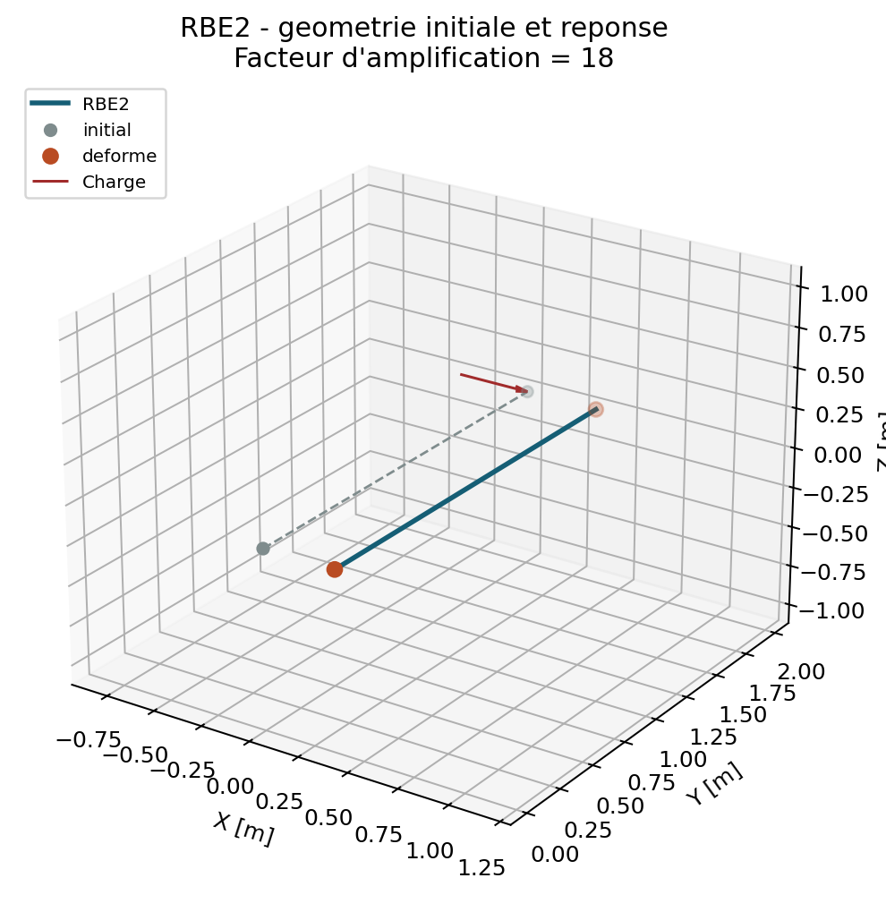

# Liaisons MPC et RBE

## Perimetre et statut V1

Le proprietaire a approuve des maturites bornees pour les configurations
lineaires statiques explicitement enumerees ci-dessous. L'approbation est
liee a l'implementation source examinee et aux configurations verifiees; elle
ne constitue ni une publication ni une qualification generale du solveur.
L'integration reste en attente d'un choix formel de branche v0.2.12 faisant
autorite et de l'approbation finale de fusion.

La campagne WP13-RBE a execute 100 cas cibles avec succes sur le checkout
source, puis les memes sept modules ont ete rejoues apres integration sur la
base v0.2.12 : 100 PASS, 0 FAIL, 0 SKIP. Le rapport source, les limites et la
provenance sont dans `qualification/0_2_12/wp13_rbe_vnv_qualification_report.md`;
la decision de maturite et la preparation d'integration sont consignees dans
`qualification/0_2_12/wp13_rbe_integration_report.md`.

| Fonctionnalite | Maturite approuvee | Domaine strictement borne |
| --- | --- | --- |
| RBE2 lin-statique | `QUALIFIED_BOUNDED` | Petites deformations; bras rigides et combinaisons acycliques verifies; rotations esclaves seulement si elles ont un sens mecanique et sont explicitement liees. |
| RBE3 `rigid_body_projection` lin-statique | `QUALIFIED_BOUNDED` | Six DDL de reference, translations independantes, poids strictement positifs et geometrie de rang six (`sigma_min/sigma_max > 1e-12`). |
| Reduction MPC acyclique lin-statique | `QUALIFIED_BOUNDED` | Contraintes affines acycliques et compatibles dans le domaine des cas verifies; cycles et incompatibilites sont refuses. |
| RBE3 `weighted` | `VERIFIED_BOUNDED` | Interpolation algebrique par composante; aucune garantie generale de conservation du moment. |
| Diagnostic de rang MPC | `VERIFIED_BOUNDED` | Au plus 180 DDL actifs; diagnostic spectral dense et heuristiques associees, pas un verdict universel de rang. |

Ces maturites n'ont pas ete inscrites dans le registre de preflight runtime
v0.2.7 : celui-ci cle par famille d'elements et type d'analyse, sans cle
distincte pour une composition RBE/MPC. Le modifier ici aurait elargi la
decision a des routes lineaires statiques non approuvees. Les resultats/runtime
existants ne sont donc pas promus automatiquement; cette decision de portee
est documentaire et liee a l'integration en revue.

`RBE2` et `RBE3` sont des noms fonctionnels courants. Ils decrivent ici le
comportement implemente par QF_solver, sans pretendre reproduire une syntaxe ou
un format proprietaire.

## MPC affine

Une contrainte multipoint est l'equation :

$$
\sum_i a_i q_i = b.
$$

Le premier terme JSON est le DDL dependant. Il definit seulement l'ordre
d'elimination ; l'equation complete reste celle affichee ci-dessus. Le solveur
construit une transformation affine :

$$
u = u_0 + Tz,\qquad K_r = T^TKT,\qquad f_r = T^T(f-Ku_0),
$$

puis resout $K_rz=f_r$. Cette reduction conserve la symetrie de $K_r$ quand
$K$ est symetrique. Les cycles, DDL repetes, pivots nuls et contraintes
conflictuelles sont refuses avant la resolution.
Le pivot dependant est controle relativement a l'echelle de sa ligne, afin
qu'une multiplication commune des coefficients ne change pas l'equation
acceptee.

La formulation a multiplicateurs de Lagrange

$$
\begin{bmatrix}K&C^T\\C&0\end{bmatrix}
\begin{bmatrix}u\\lambda\end{bmatrix}
=
\begin{bmatrix}f\\b\end{bmatrix}
$$

est conservee comme oracle de verification sur les petits systemes. Elle n'est
pas le chemin nominal, car elle transforme le systeme en matrice selle.

## RBE2 : bras rigide

Pour un noeud esclave $s$, un maitre $m$ et le bras
$r=x_s-x_m$, QF_solver impose les trois relations globales :

$$
u_s = u_m + \theta_m \times r.
$$

Les rotations du maitre sont donc activees meme si le maitre est raccorde a
des solides. L'option `tie_rotations: true` ajoute seulement
$\theta_s=\theta_m$ ; elle est a utiliser lorsque les rotations esclaves ont
un sens mecanique, typiquement avec BEAM2 ou MITC4. Le gestionnaire de DDL
ajoute les rotations citees par une MPC, meme si l'element solide du noeud ne
porte nativement que des translations. `tie_rotations` n'est donc pas
automatiquement valide par la famille d'elements : sur un esclave solide,
les rotations ajoutees sont des coordonnees cinematiques sans raideur propre.
Ne l'activer que si cette egalite a un sens pour le modele.

## RBE3 : distribution par projection rigide

Le mode par defaut `rigid_body_projection` relie les translations des noeuds
independants aux six coordonnees generalisees de reference. Avec
$r_i=x_i-x_r$, le bloc cinematique au noeud $i$ est :

$$
A_i = \begin{bmatrix} I & -S(r_i) \end{bmatrix},
\qquad u_i=A_iq_r.
$$

Le solveur construit la projection ponderee :

$$
H=(A^TWA)^{-1}A^TW,\qquad q_r=H u_I.
$$

Les poids sont strictement positifs et les noeuds independants doivent porter
les six mouvements rigides. Par travail virtuel, un torseur applique a la
reference est redistribue par $f_I=H^Tp$. La resultante et le moment sont donc
conserves. Cette liaison ajoute des equations cinematiques, jamais une
raideur. Le calcul numerique centre les points autour de leur barycentre
pondere, met les colonnes de rotation a l'echelle de la taille du nuage et
resout les moindres carres ponderes par SVD. Il est algebriquement equivalent
a $H=(A^TWA)^{-1}A^TW$, sans former les equations normales. Le rang est refuse
si $\sigma_{min}/\sigma_{max} \le 10^{-12}$ apres mise a l'echelle. Ainsi,
une geometrie de rang plein n'est pas rejetee uniquement parce que le modele
est exprime en millimetres ou a une autre echelle de coordonnees. Les poids
partagent une normalisation par facteur commun; cette echelle ne modifie pas
la projection.

Le mode explicite `weighted` reste disponible pour un cas scalaire ou 1D :

$$
q_r - \sum_i \frac{w_i}{\sum_j w_j}q_i = 0.
$$

Il normalise les poids mais ne garantit pas le moment pour une geometrie 3D;
il ne doit pas etre employe comme distributeur spatial de charge. Des poids
signes sont permis si leur somme normalisee n'est pas presque annulee; cela
represente une interpolation/extrapolation algebrique, pas necessairement une
moyenne convexe.

## Portee par rapport aux RBE de Nastran

Les noms sont fonctionnels et ne promettent pas une equivalence de fichier ou
de toutes les variantes Nastran. Le mode `rigid_body_projection` reconstruit
six coordonnees generalisees depuis les seules translations des noeuds
independants, avec un unique jeu de poids positif pour les trois composantes
de chaque noeud. Le mode `weighted` cree une equation scalaire par composante
choisie. Les jeux de composantes independantes `UM`, les groupes de composantes
et poids distincts, les systemes de coordonnees locaux, et les formulations
Nastran plus generales ne sont pas implementes. La validation externe actuelle
est limitee a un bras RBE2.

## Reactions et controles

Apres la resolution, QF_solver recupere les multiplicateurs par :

$$
K u-f+C^T\lambda=0.
$$

L'audit publie les vingt multiplicateurs les plus importants, la compatibilite
$\lVert Cu-b\rVert$, la fermeture de l'equilibre en espace complet et les
fermetures globales de force et moment. Les reactions legacy sur blocages
conservent leur convention historique `Ku-f`; elles ne doivent pas etre
confonduees avec $C^T\lambda$.
Le graphe de composantes et le diagnostic de rang comptent maintenant les
liaisons MPC/RBE. Lorsque le nombre de DDL permet le diagnostic dense, le rang
est mesure sur le systeme reduit, apres prise en compte des liaisons et des
blocages.

## JSON

```json
{
  "multipoint_constraints": [
    {
      "name": "tie_x",
      "terms": [
        {"node": 4, "dof": "UX", "coefficient": 1.0},
        {"node": 2, "dof": "UX", "coefficient": -1.0}
      ],
      "value": 0.0
    }
  ],
  "rbe2": [{"master": 0, "slaves": [1, 2], "tie_rotations": false}],
  "rbe3": [{
    "mode": "rigid_body_projection",
    "reference": 3,
    "independents": [
      {"node": 4, "weight": 1.0},
      {"node": 5, "weight": 1.0},
      {"node": 6, "weight": 1.0}
    ]
  }]
}
```

Voir aussi `examples/rbe2_rigid_arm.json`,
`examples/rbe2_rigid_offset_combined_wrench.json`,
`examples/rbe3_unequal_weight_projection.json`,
`docs/elements/rbe_user_examples.md`, ainsi que
`tests/unit/test_mpc_reduction.py` et `tests/unit/test_rbe_links.py`.

## Correlation externe RBE2

`VNV-RBE2-CODEASTER-RIGID-ARM-001` compare un bras de longueur `2 m`, relie
par les six relations cinematques exactes du RBE2 a un maitre ressorti en
translation `UX`. Une force `FX = 20 N` est appliquee a l'esclave. Le jeu de
reference Code_Aster 18.1.0 emploie `LIAISON_DDL`, pas un format RBE
proprietaire :

$$
u_{x,s}-u_{x,m}+2\theta_{z,m}=0,
\quad u_{y,s}-u_{y,m}=0,
\quad u_{z,s}-u_{z,m}-2\theta_{x,m}=0.
$$

Le resultat deplace `UX` est `0.02 m` dans les deux solveurs, avec un ecart
relatif mesure de `3.47e-18`. La commande reproductible est :

```powershell
python .\scripts\run_code_aster_rbe_vnv.py
```

Le rapport et son manifeste sont ecrits dans
`results/VNV-RBE2-CODEASTER-RIGID-ARM-001`. Cette campagne valide la
cinematique de transfert en statique. `REAC_NODA` de Code_Aster ne restitue
pas la reaction associee a la liaison duale dans cette configuration : le
moment de `40 N.m` reste donc verifie en interne par l'audit QF_solver et par
la comparaison elimination/multiplicateurs, non par cette colonne externe.
Dans le checkout examine pour l'audit present, le dossier de resultats de cette
campagne n'est pas present et le moteur Docker n'etait pas disponible. Le
resultat `3.47e-18` ci-dessus reste donc une preuve historique documentee; il
n'a pas ete rejoue ni independamment reconstitue pendant cette revision.

## Limites et precautions

- Les MPC/RBE ne sont pas encore composes avec modal, Newmark, harmonique,
  non-lineaire ou contact. Les routes bornees refusent ces combinaisons; aucune
  transformation coherente de $K$, $M$, $C$ et des chargements dynamiques n'est
  activee.
- Une liaison peut masquer un mecanisme de modele ; le rapport de rang et les
  warnings de maillage restent a examiner.
- Les multiplicateurs sont recuperes pour l'audit statique, mais modal,
  Newmark, harmonique, non-lineaire et contact ne les composent pas encore.
- Aucun RBE ne corrige un maillage insuffisant, une singularite ou un mauvais
  choix d'element.
- La preuve Code_Aster courante ne couvre ni RBE3, ni plusieurs bras, ni les
  reactions de multiplicateurs, ni les noeuds raccordes a une structure
  deformable.

## Contrat documentaire et demonstration

| Rubrique exigee | Contenu et preuve |
| --- | --- |
| Geometrie et DDL | Maitre, esclaves et bras geometriques; composantes actives explicites. |
| Formulation mathematique | Contraintes $Cq=d$, cinematique rigide RBE2 et projection RBE3. |
| Integration et algorithme | Pas de quadrature; elimination affine et controle par multiplicateurs. |
| Exemple executable | `python .\qf_solver.py solve --input .\examples\rbe2_rigid_arm.json --output .\results\rbe2.json` |
| Maillage | Bras rigide minimal a trois noeuds. |
| Chargement et conditions limites | Maitre bloque selon le JSON, charge sur un noeud lie. |
| Tableau de resultats | Tableau genere ci-dessous. |
| Figure de deformee | Bras initial, charge et mouvement contraint. |
| Invariants | Rang, compatibilite, mouvement rigide, resultante et moment transmis. |
| Convergence | Comparaison elimination/Lagrange et correlation Code_Aster. |
| Limites | V1 statique lineaire et conflits de contraintes refuses. |
| References | `REF-FEM-BATHE`, exigences MPC/RBE et preuves Code_Aster. |

--8<-- "docs/generated/assembly_element_results.md"

{ .result-figure }

La decision Owner du 21 octobre 2026 approuve les maturites bornees du tableau
ci-dessus pour cette implementation et ce perimetre uniquement. La branche
d'integration n'est pas encore fusionnee dans une branche v0.2.12 faisant
autorite; aucune publication publique ni promotion d'autres routes n'est
autorisee.
