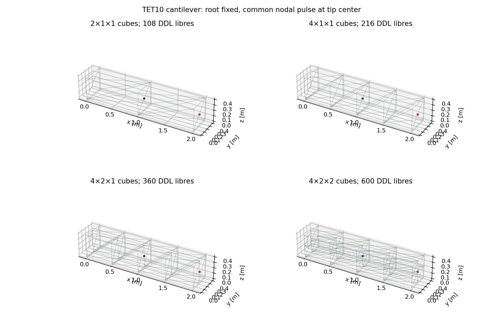
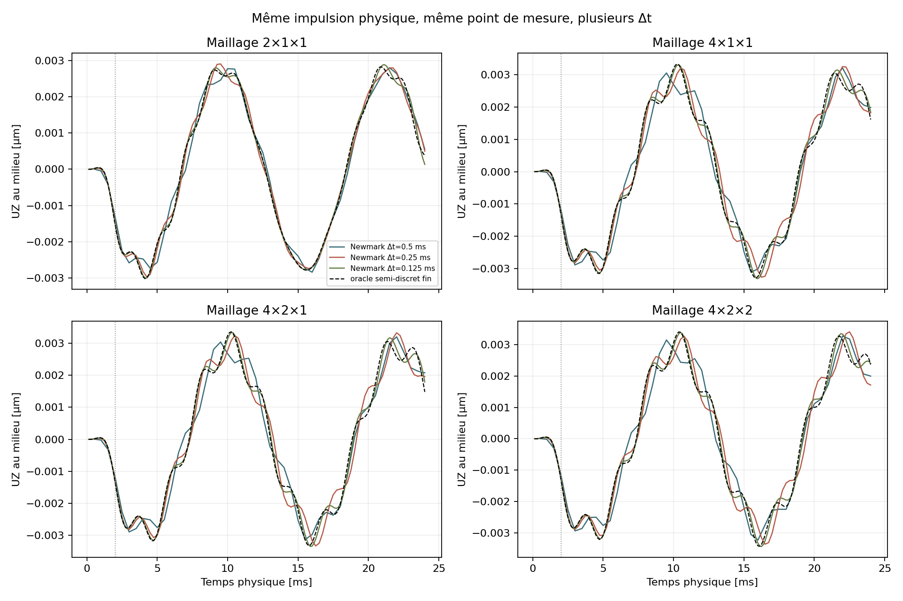
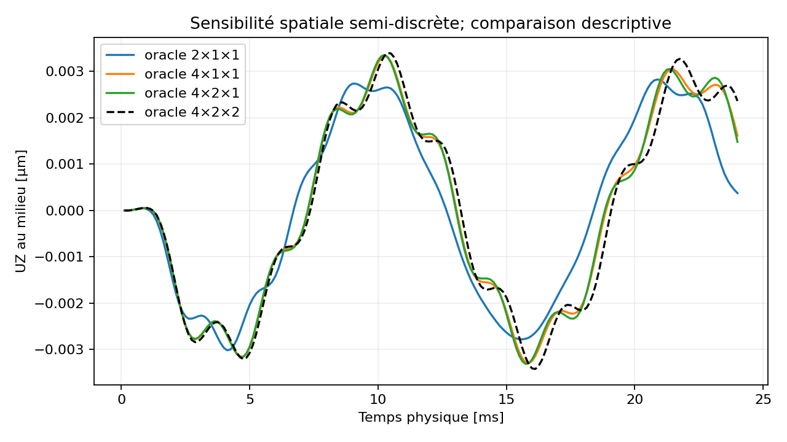
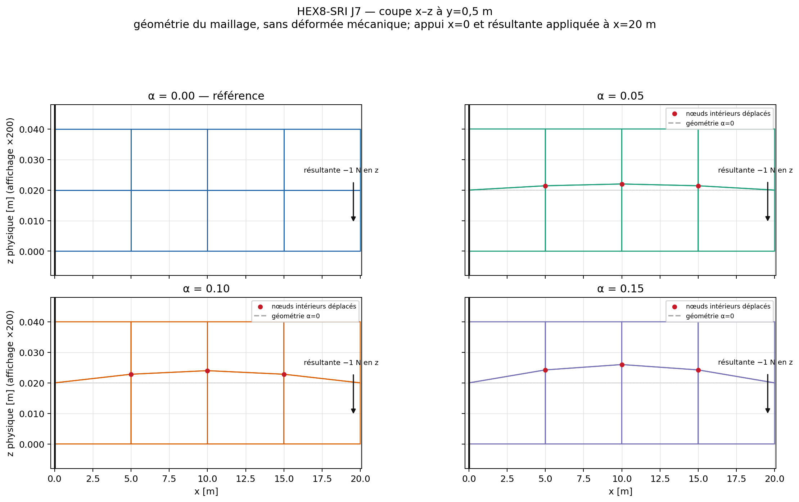
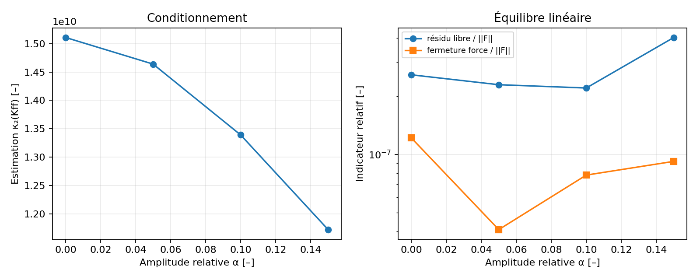

# QF Solver 0.3.0 — J10 : transitoire TET10 et diagnostic HEX8-SRI

**Date :** 2026-11-16

**Statut :** études exploratoires bornées. Elles ne qualifient pas le solveur et ne changent aucun verdict historique.

## 1. Baseline, branches et traces

| Référence | État vérifié |
|---|---|
| `origin/main` | `be455745f4a1c2cf81cb9448830223107dc39b66` |
| Branche J9 | `work/0.3.0-j9@8183d4eb74c6ad56ffb03fad62642ffd7cd6b0c9` |
| Baseline de J10 | J9, ancêtre direct de la branche J10 |
| Branche J10 | `work/0.3.0-j10` |
| Worktree utilisateur préexistant | `emptiesvoids-cloud/0.2.12@2aa994f34900f39bef8df9db5fb025157fb694bb`, resté intact |

PR #136 est ouverte en brouillon, base `main`, tête J8. PR #137 est ouverte en brouillon, base J8, tête J9. Le dépôt distant n’avait pas encore de branche J10 au contrôle final avant publication. La branche J10 reste cumulative depuis J9; une éventuelle PR doit être empilée sur J9.

Les sources gelées diffèrent selon les exécutions : le transitoire a utilisé `62ab1f57079510e7877cb0fb8f8ce8e9e3c4d26a`, le diagnostic HEX8 réussi `2999fb980ccfd3b7fe97cb724b1be43330507879`, et le correctif modal `1b3e7d365ccfc8675fba9c796a2fdfebc579c4b7`. Deux commits intermédiaires ont corrigé le schéma du contrat HEX8 (`599427ecc5708981e0cf5f0077091b4449b65cac`) puis la vérification du SHA brut (`2999fb98…`). Aucun algorithme du solveur n’a été modifié.

Les manifestes J10, reçus bruts et journaux complets du runner restent dans le stockage local ignoré `.codex/development-runs/`, car ils contiennent des racines de worktree. L’archive suivie contient les données de calcul, contrats, empreintes et reçus assainis. Le manifeste SHA-256 est sous [`research/j10/results/diagnostic-2026-11-16/`](../../research/j10/results/diagnostic-2026-11-16/).

## 2. Axe A — TET10 sous une excitation physique commune

### Contrat et limites du modèle

Le contrat [`tet10_fixed_excitation_contract.json`](../../research/j10_transient/contracts/tet10_fixed_excitation_contract.json) fixe un solide `2 × 0,4 × 0,4 m`, `E=70 GPa`, `ν=0,30`, `ρ=2700 kg/m³`, unités SI, masse cohérente, conditions initiales nulles, amortissement nul et Newmark moyen (`β=0,25`, `γ=0,5`). La face `x=0` est fixée en translation. Une force nodale en `−Z` est appliquée au centre de la face `x=L`; sa fonction est identique en temps physique pour tous les maillages : `0 N` à `0 ms`, `−1 N` à `1 ms`, puis `0 N` à `2 ms`, observation jusqu’à `24 ms`. La résultante assemblée est `−1 N`.

Le point de mesure principal est `UZ` au milieu physique `(1; 0,2; 0,2) m`, à distance de la force ponctuelle. La force nodale a une singularité locale; les valeurs de contrainte près de ce point ne sont pas utilisées ici. Les quatre maillages sont des subdivisions TET10 conformes; les raffinements sont séquentiels et touchent successivement la longueur puis les deux directions transverses.

| Cellules de boîte | Éléments | Nœuds | DDL libres | `f₁` semi-discrète (Hz) | Pic `|UZ|` à `dt=0,125 ms` (nm) | Erreur RMS Newmark/oracle au pas fin (%) | Ordres temporels observés | Erreur RMS spatiale à la maille la plus fine (%) |
|---|---:|---:|---:|---:|---:|---:|---:|---:|
| `2×1×1` | 12 | 45 | 108 | 85,6469 | 3,0052 | 2,0967 | `0,547 / 1,137` | 22,9786 |
| `4×1×1` | 24 | 81 | 216 | 82,6433 | 3,3176 | 3,2235 | `0,193 / 1,709` | 7,1635 |
| `4×2×1` | 48 | 135 | 360 | 82,0855 | 3,3430 | 3,6765 | `0,113 / 1,662` | 8,5867 |
| `4×2×2` | 96 | 225 | 600 | 81,9754 | 3,4302 | 3,7247 | `0,083 / 1,729` | référence de comparaison |

Chaque maille a `48`, `96` puis `192` pas pour `dt=0,5`, `0,25` et `0,125 ms`. L’erreur temporelle RMS est normalisée par le pic global de l’oracle, `3,422617×10⁻⁹ m`, afin d’éviter les erreurs relatives instables aux passages par zéro. À chaque maille, les valeurs Newmark diminuent en général quand `dt` décroît; les ordres observés entre les deux intervalles varient selon le maillage (`0,083–0,547`, puis `1,137–1,729`). Trois pas ne montrent pas encore un régime asymptotique uniforme.

L’oracle propage chaque intervalle de charge affine par un modèle modal semi-discret construit à partir des mêmes `M` et `K` TET10 assemblés. Il vérifie l’intégration temporelle pour les opérateurs de chaque maillage, pas leur exactitude spatiale indépendante. La colonne spatiale compare les courbes à la maille la plus fine aux mêmes temps physiques; elle décrit la sensibilité entre ces quatre modèles et ne constitue pas une erreur au continuum. Elle n’est pas monotone entre `4×1×1` et `4×2×1`, et aucun ordre de convergence spatial n’est revendiqué.

Les contrôles descriptifs montrent une énergie totale post-pulse stable à environ `1,1×10⁻¹²–3,0×10⁻¹²` relatif, un écart travail/énergie finale de `3,2×10⁻¹⁴–9,9×10⁻¹³`, et des résidus dynamiques maximums de l’ordre de `4,3×10⁻¹³–1,14×10⁻¹² N`. Ce sont des diagnostics internes à ce calcul, sans seuil formel d’acceptation. Aucun solveur externe utilisable n’était présent (`as_run` et `ccx` absents; Docker sans moteur disponible); il n’y a donc pas de corrélation indépendante ni de référence continuum.

Les résultats archivés conservent des signaux aux sondes et des états/opérateurs pour l’analyse, mais pas les champs nodaux complets à tous les temps. Aucune animation temporelle de déformée n’est donc fournie.

La coupe géométrique HEX8 ci-dessous est un post-traitement du NPZ archivé; elle n’effectue aucun assemblage ni résolution. Elle montre le plan `y=0,5 m`; l’axe vertical `z` est agrandi visuellement par `200`, tandis que ses graduations restent exprimées en mètres physiques. La flèche est la résultante totale, pas une pression distribuée.

## 3. Axe B — HEX8-SRI proche du cas quasi dégénéré J7

### Expérience contrôlée

Le contrat correctif [`hex8_j7_distortion_corrective_contract_003.json`](../../research/j10_hex8/contracts/hex8_j7_distortion_corrective_contract_003.json) reprend bit à bit les coordonnées extérieures, connectivité, masque d’appui et vecteur de charge du cas quasi dégénéré J7 `4×2×2` (`16` éléments, `45` nœuds, `108` DDL libres). Le matériau est `E=1 MPa`, `ν=0,495`. La charge totale vaut `(0,0,−1) N`; les translations de la face `x=0` sont bloquées.

Un seul paramètre change : les trois nœuds intérieurs sont déplacés en `z` de `δz = α·0,04·sin(πx/20)`, avec `α=0; 0,05; 0,10; 0,15`. L’enveloppe extérieure reste fixe, les jacobiens de Gauss restent positifs et le volume intégré demeure constant; le précontrôle géométrique J10 a le statut `PASS_GEOMETRY_ONLY`. Le niveau `α=0` reproduit exactement (différence relative nulle) la matrice et le déplacement J7 archivés.

Le diagnostic réassemble une matrice dense en appelant `Hex8SRIElement.stiffness` pour chaque élément; NumPy résout `Kff·uf=ff` et SciPy fournit un second solveur symétrique sur le même système réduit. Ce script de diagnostic n’emprunte pas la route de production complète `GlobalAssembler`/`solve_model`. Les métriques sont définies par les normes 2 : résidu libre `||Kff·uf−ff||/max(||F||,1 N)`, fermeture de force `||Fext+R||/max(||F||,1 N)` et fermeture de moment `||Mext+Mréac||/max(||F||·20 m,1 N·m)`. Les rapports sont sans dimension; le résidu absolu est en N et le moment résiduel en N·m.

| `α` | Déplacement intérieur max (mm) | `κ₂(Kff)` estimé | Résidu libre / force | Fermeture force | Fermeture moment | Différence de déplacement vs J7 `α=0` |
|---:|---:|---:|---:|---:|---:|---:|
| 0,00 | 0 | `1,511×10¹⁰` | `2,581×10⁻⁷` | `1,217×10⁻⁷` | `2,224×10⁻⁷` | 0 |
| 0,05 | 2 | `1,464×10¹⁰` | `2,293×10⁻⁷` | `4,083×10⁻⁸` | `6,300×10⁻⁸` | `1,637×10⁻⁴` |
| 0,10 | 4 | `1,339×10¹⁰` | `2,205×10⁻⁷` | `7,816×10⁻⁸` | `1,991×10⁻⁷` | `6,404×10⁻⁴` |
| 0,15 | 6 | `1,172×10¹⁰` | `4,024×10⁻⁷` | `9,203×10⁻⁸` | `1,478×10⁻⁷` | `1,440×10⁻³` |

Les résidus arrière sont de l’ordre de `5×10⁻¹⁷–9×10⁻¹⁷`, tandis que les fermetures mécaniques ne suivent pas une évolution monotone. Le conditionnement estimé baisse au fil de cette distorsion précise, mais cela ne démontre pas que la géométrie explique les FAIL J7 : la réponse et les bilans changent aussi avec la matrice, et l’estimation de conditionnement ne mesure pas l’erreur physique. Un second solveur symétrique sur les mêmes matrices donne des différences de déplacement de l’ordre de `1×10⁻⁷`; ce n’est pas une référence indépendante de formulation. La flèche maximale, environ `0,096 m`, dépasse largement l’échelle locale d’épaisseur `0,04 m`; l’interprétation linéaire est donc limitée.

Le J7 quasi dégénéré garde son statut historique **FAIL** (résidu libre `2,581×10⁻⁷`, fermeture force `1,217×10⁻⁷`, fermeture moment `2,224×10⁻⁷`, ainsi que l’échec énergétique historique). Le cas régulier J7 (`16×2×2`, `ν=0,4999`) reste lui aussi **FAIL**; ce jalon n’a pas tenté de l’expliquer à partir de ce balayage unique. Les matrices et états J7 n’ont pas été modifiés.

## 4. Axe C — Route modale TET10

Le contrat [`tet10_modal_route_smoke_corrective_contract.json`](../../research/j10_modal/contracts/tet10_modal_route_smoke_corrective_contract.json) borne un seul TET10 tétraédrique droit, `E=70 GPa`, `ν=0,30`, `ρ=2700 kg/m³`, face `x=0` fixée, `30` DDL totaux et `12` libres. QF demande quatre modes avec `eigsh` et validation stricte.

| Mode | QF (Hz) | `eigh` dense sur les mêmes `Kff/Mff` (Hz) | Écart relatif |
|---:|---:|---:|---:|
| 1 | 1003,487519 | 1003,487519 | `3,74×10⁻¹⁵` |
| 2 | 1186,027610 | 1186,027610 | `4,22×10⁻¹⁵` |
| 3 | 2340,747666 | 2340,747666 | 0 |
| 4 | 2444,255611 | 2444,255611 | `9,30×10⁻¹⁶` |

Statut numérique QF : `PASS`; les quatre validations de résidu du résultat sont `PASS_CERTIFIED` sur les opérateurs et les vecteurs représentés pour ce système de 12 DDL. L’écart maximal de fréquence à une résolution dense indépendante du solveur, mais appliquée aux **mêmes opérateurs QF**, est `4,22×10⁻¹⁵`. Ceci contrôle le trajet eigensolveur et la sortie modale sur ce petit modèle. Cela ne vérifie ni l’assemblage spatial TET10, ni une fréquence au continuum, ni la réponse modale du cantilever J9. L’échec J9 à `aggregate_work_budget` sur sa base complète à `108` DDL reste inchangé.

## 5. Tentatives, contrôles logiciels et ressources

Les trois familles ont chacune des contrats distincts. Budgets FEM : `1800 s`, RSS souple `2048 MiB`, `4` processus, sorties capturées `8 MiB` au total et `4 MiB` par flux, temporaires `512 MiB`, archive `128 MiB`, un thread numérique et au moins `1 GiB` libre. RSS, processus, temporaires et espace disque sont observés par échantillonnage; ils ne sont pas des quotas OS.

Les huit préflights exacts ont tous passé en collect-only sans exécuter de corps de test. Six ont été consommés par les essais listés; deux sont restés inutilisés lorsque l’empreinte source a changé, et sont marqués comme périmés dans l’archive.

| Exécution | Résultat | Durée | Pic RSS | Archive |
|---|---|---:|---:|---:|
| TET10 pulse commun, 12 cas | `PASS` exploratoire | 59,08 s | 254 148 608 B | 1 482 055 B |
| HEX8 essai 1 | `PYTEST_FAILED`, avant lecture des entrées et assemblage (`KeyError: input`) | 4,20 s | 128 229 376 B | 1 847 B |
| HEX8 essai 2 | `PYTEST_FAILED`, empreinte brute J7 non conforme avant assemblage | 3,89 s | 127 754 240 B | 2 386 B |
| HEX8 essai 3, α=0–0,15 | `PASS` exploratoire | 6,07 s | 162 172 928 B | 351 241 B |
| Modale essai 1 | `PYTEST_FAILED` après retour de `ModalResult`, sérialisation non atteinte | 4,80 s | 157 974 528 B | 3 497 B |
| Modale essai 2, contrat correctif | `PASS` exploratoire | 4,80 s | 156 962 816 B | 10 475 B |

Les essais correctifs ont leurs propres contrats et séries dans le ledger; les tentatives antérieures restent distinctes. L’essai HEX8 1 a rencontré un décalage de schéma (`input` attendu par le harnais contre `inputs` dans le contrat). L’essai 2 a ensuite détecté qu’un SHA canonique LF était présenté comme SHA brut alors que le fichier archivé avait des fins de lignes CRLF. L’empreinte brute a été vérifiée et le contrat correctif 003 a été établi. Ces deux échecs sont des échecs du harnais/intégrité avant FEM, pas des résultats mécaniques.

Le premier essai modal a réellement appelé le solveur, puis le harnais a lu `result.numerical_status`, attribut absent de `ModalResult` qui expose `status`. Le correctif lit le champ existant et exige le tableau plein exact `(30,4)` si QF annonce PASS. Un test unitaire vérifie le contrat, l’interface corrigée, le budget d’essai et le schéma des modes.

Le postprocesseur de coupe géométrique a d’abord échoué sur la fermeture d’un tableau d’indices; le tracé a été corrigé, recompilé et régénéré depuis le NPZ archivé. Cette correction graphique n’a lancé ni assemblage ni calcul FEM et n’a pas changé les données sources.

Les quatre tests unitaires ciblés du runner, de la portée J10, de l’intégrité d’entrée J7, du contrat modal correctif et du préflight exact ont passé via `scripts/development_autonomous.py`, un nodeid par commande. Les nodeids transitoire, HEX8 3 et modal 2 ont aussi terminé avec `PASS` du runner; leurs portées restent celles des contrats exploratoires. Aucun test complet du dépôt n’a été exécuté.

## 6. Fichiers, confidentialité et suite

Les courbes temporelles, données de sondes, états NPZ, matrices, fréquences modales, contrats, reçus assainis et manifestes sont sous [`research/j10/results/diagnostic-2026-11-16/`](../../research/j10/results/diagnostic-2026-11-16/). Les CSV/JSON permettent la préparation de la galerie; aucune fiche n’a été publiée sur le site. Les PNG de déplacement/déformée restent des démonstrations visuelles. Le runner ne produit pas de champs nodaux complets par instant pour le transitoire, donc pas d’animation temporelle.

La recherche d’un exécutable externe n’a pas trouvé `as_run` ou `ccx`; le moteur Docker n’était pas joignable. Les écarts temporels utilisent donc les opérateurs du solveur, et le test modal compare deux solveurs algébriques sur les mêmes `K/M`. Aucune référence externe ou continuum n’est revendiquée.

Après vérification du diff J10 contre J9 et des chemins publics, la PR [#138](https://github.com/emptiesvoid-cloud/QF_solver/pull/138) a été ouverte en brouillon avec base `work/0.3.0-j9` et tête `work/0.3.0-j10`. Elle est empilée sur la PR #137, encore ouverte en brouillon, et n’implique aucune fusion ni publication du site. Les FAIL J7 et J9 restent intacts.

**Jalon suivant recommandé :** établir une comparaison dynamique spatialement indépendante pour un cas TET10 (référence analytique adaptée ou solveur externe rétabli), avec une convergence transversale contrôlée et la même charge physique. Garder le diagnostic HEX8-SRI comme axe séparé : pour l’isolation de sa cause, il faut encore comparer séparément reconstruction de résidu/réactions, conditionnement et formulation sur des systèmes globalement plus grands. Ne pas généraliser le petit test modal à la famille TET10.
