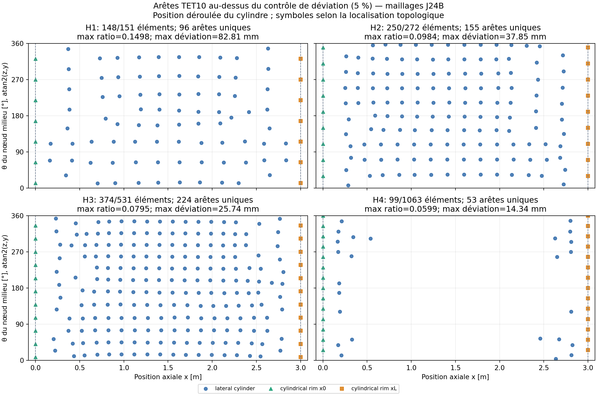

# J24C — diagnostic des avertissements de courbure TET10

**Statut :** post-traitement des archives J24B uniquement. Aucun calcul FEM n’a été relancé. Les statuts historiques sont conservés.

## Résumé

Le contrôle « nœuds milieux » mesure l’écart d’un nœud milieu à l’arête droite entre les deux nœuds de coin. Il émet un avertissement lorsque le rapport dépasse 5 %, avec une seule entrée par élément fondée sur le maximum de ses six arêtes.

Les quatre maillages reconstruits montrent que toutes les arêtes averties sont des arêtes de bord associées au cylindre de rayon 0,5 m : soit sur la surface latérale, soit sur la rive circulaire à `x=0` ou `x=L`. Aucune arête avertie n’est intérieure ou située à l’intérieur d’une face d’extrémité plane. Les nœuds des arêtes identifiées restent sur le rayon analytique à la précision flottante. Cela établit que la courbure est la cause géométrique du franchissement du seuil pour ces arêtes.

Le contrôle est néanmoins un indicateur de non-linéarité par rapport à une corde, pas un contrôle qui distingue une courbure voulue d’un nœud mal placé. En H1, 20 arêtes latérales averties ont leur nœud milieu à plus de 10 mm du milieu angulaire de l’arc circulaire le plus court reliant les extrémités (maximum 29,78 mm). Ce décalage angulaire mérite une vérification géométrique ciblée ; les données ne suffisent pas à conclure qu’il invalide l’élément ou qu’il cause les erreurs mécaniques observées.

Les 35 valeurs de jacobien échantillonnées par élément sont toutes positives et aucun autre seuil qualité archivé n’est franchi. Cet échantillonnage fini ne certifie pas la positivité partout dans le domaine de chaque TET10 courbe.

## Baseline et provenance

- `main` contrôlé : `be455745f4a1c2cf81cb9448830223107dc39b66`.
- PR #150 : ouverte, en brouillon, base `main`, tête `de3f39c536da73cf43cd19bae58b27a78bb528b2` au contrôle du 18 novembre 2026.
- Branche J24C locale : `work/0.3.0-j24c`, créée isolément depuis la tête exacte de #150. Le checkout utilisateur initial et les autres worktrees n’ont pas été modifiés.
- Source FEM R1 : `275c5788e4eaded1ea4305630ea1b0eb0b88158c`, arbre `a21b7d06ce1aff00f565d39ca24b2ce1073abf53`.
- Les blobs des fichiers de définition utilisés ici sont identiques entre la source R1, la branche #150/J24C et `main` : `quality.py` (`1cc0a2a8…`), `validation.py` (`77b137e6…`), `tet10.py` (`fba7baf2…`) et `gmsh_factory.py` (`cbe30fce…`).
- Contrat gelé `J24B-TET10-CIRCULAR-TORSION-STATIC-002`, SHA-256 `1c1b63da996750baf28c7750936d4532ac95644d4ff317344113324e12331e5e`.
- Archive `raw_results.zip`, SHA-256 `61a916e5dce3d09804ab2b8110f41eeba4c449257f7ea1f80536c64616dae6ff`, 41 entrées de données vérifiées par le manifeste interne (42 entrées ZIP avec le manifeste).
- Le post-traitement a aussi vérifié les quatre empreintes maillage/configuration du contrat et a retrouvé exactement les indices d’éléments avertis contenus dans les checkpoints archivés.
- Environnement de post-traitement : Python 3.13.1, NumPy 2.2.6, Matplotlib 3.10.3. SHA-256 du script `analyze_archived_campaign.py` : `7a8dd71582e6d4a7d918734cdf3fde1380a193a5f9b6ba9db8c2f9dafb71ab2e`.

Le contrat 001 garde son statut `PYTEST_FAILED` et sa campagne `INCONCLUSIVE`. Le contrat 002 reste `PASS` pour la configuration bornée H1–H4. Les verdicts d’audit général restent `WARNING` aux quatre niveaux.

## Définition exacte du contrôle

Dans `src/solveur/elements/solid/tet10.py`, `Tet10Element.geometry_diagnostics` parcourt les six triplets `(coin a, coin b, nœud milieu)`. Pour chaque arête :

```text
d = ||x_milieu - (x_coin_a + x_coin_b)/2||
r = d / ||x_coin_b - x_coin_a||
```

`src/solveur/mesh/quality.py` fixe `tet10_max_mid_edge_deviation_ratio = 5e-2`. Dans `src/solveur/mesh/validation.py`, l’élément reçoit le texte `curved or misplaced TET10 midside node` si `max(r)` sur ses six arêtes est strictement supérieur à `0,05`. Le contrôle ne vérifie pas la position par rapport à une surface CAD ou une courbe cible. Une arête TET10 intentionnellement courbe peut donc déclencher le même avertissement qu’un nœud déplacé.

Pour une arête qui suit exactement un arc circulaire avec nœud à mi-angle, le rapport vaut `0,5 tan(Δθ/4)`. Le seuil de 5 % est franchi pour un angle d’arc supérieur à environ `22,85°`. Cela explique pourquoi la courbure attendue d’un maillage grossier peut déclencher le contrôle, sans démontrer que le maillage est incorrect.

## Localisation et écart par maillage

« Incidences locales » compte chaque arête au niveau de l’élément qui la contient ; une arête partagée peut compter plusieurs fois. « Arêtes uniques » déduplique par les deux nœuds de coin. Les comptes de localisation ci-dessous sont des arêtes physiques uniques ; les colonnes d’incidences montrent les duplications locales. Aucune arête de face plane, autre frontière ou intérieure n’a dépassé le seuil.

| Niveau | Nœuds / éléments | Éléments avertis | Incidences d’arêtes locales | Arêtes uniques | Localisation des arêtes uniques : latérale / rive x=0 / rive x=L | Ratio maximal | Déviation absolue maximale |
|---|---:|---:|---:|---:|---:|---:|---:|
| H1 | 348 / 151 | 148 | 231 | 96 | 82 / 7 / 7 | 0,149775 (14,98 %) | 82,807 mm |
| H2 | 605 / 272 | 250 | 360 | 155 | 137 / 9 / 9 | 0,098374 (9,84 %) | 37,849 mm |
| H3 | 1 056 / 531 | 374 | 542 | 224 | 202 / 11 / 11 | 0,079510 (7,95 %) | 25,744 mm |
| H4 | 1 992 / 1 063 | 99 | 99 | 53 | 25 / 14 / 14 | 0,059854 (5,99 %) | 14,341 mm |

La localisation déroule le cylindre selon `x` et l’angle `atan2(z,y)`. Les rives à `x=0` et `x=L=3 m` restent séparées de la surface latérale. Les trois points de chaque arête avertie (ses deux extrémités et son nœud milieu) sont sur `R=0,5 m` à une tolérance géométrique de `1e-8 m`; l’erreur radiale maximale rapportée pour les milieux est de l’ordre de `1,1e-13 mm`.



### Décalage au milieu d’arc en H1

La distance complémentaire compare le nœud milieu au milieu angulaire de l’arc court passant par les deux extrémités, à la même abscisse. En H1, pour les 82 arêtes latérales averties : médiane `0,629 mm`, 95e percentile `25,46 mm`, 40 arêtes au-dessus de 1 mm et 20 au-dessus de 10 mm ; maximum `29,78 mm`. La principale arête concernée est associée aux éléments 11, 22 et 95, vers `x=1,843 m`. Les médianes locales de ces éléments sont de 0,259–0,318 % pour le déplacement et 2,679–4,269 % pour le cisaillement aux points d’intégration.

En H2–H4, ce même écart est inférieur à `1,4e-12 m` sur les arêtes latérales averties, donc compatible avec l’arrondi. Le générateur appelle `gmsh.model.mesh.setOrder(2)` puis `gmsh.model.mesh.optimize("HighOrder")`. Cette optimisation est une piste plausible pour la différence H1, mais les archives ne démontrent pas qu’elle en est la cause. La géométrie discrète reste quadratique ; les seuls nœuds sur le cercle ne prouvent pas que toute la courbe interpolée reste sur le cercle entre les nœuds.

## Jacobien et qualité complémentaire

Le Jacobien est évalué sur la maille barycentrique fermée de degré 4, soit 35 points par élément, selon `Tet10Element.jacobian_determinants`. Les métriques de qualité, rayon et volume relatif sont celles du tétraèdre des quatre nœuds de coin, pas des bornes certifiées de la géométrie quadratique.

| Niveau | Points `det J` | Min échantillonné `det J` [m³] | Non positifs / sous `1e-14` | Min par élément de `min(det J)/max(det J)` | Qualité coin min | Ratio de rayon min | Rapport d’aspect max | Volume relatif min |
|---|---:|---:|---:|---:|---:|---:|---:|---:|
| H1 | 5 285 | 9,966e-3 | 0 / 0 | 0,2339 | 0,3008 | 0,3107 | 2,153 | 0,01581 |
| H2 | 9 520 | 2,041e-2 | 0 / 0 | 0,7088 | 0,4251 | 0,4944 | 2,287 | 0,02760 |
| H3 | 18 585 | 9,088e-3 | 0 / 0 | 0,7049 | 0,2628 | 0,3383 | 2,435 | 0,01511 |
| H4 | 37 205 | 3,674e-3 | 0 / 0 | 0,6913 | 0,2639 | 0,3056 | 2,525 | 0,01716 |

Aucun élément n’a franchi les seuils archivés d’erreur ou d’autres avertissements qualité ; aucun ratio Jacobien échantillonné n’est passé sous `0,05`. Les `det J` absolus diminuent avec la taille des éléments et ne sont pas directement comparables comme score de qualité. Un échantillonnage fini ne démontre pas `det J>0` partout ; une certification demanderait une méthode de bornage, par exemple un contrôle polynomial avec subdivision ou intervalles.

## Comparaison aux erreurs mécaniques archivées

Les erreurs sont recalculées par élément contre le champ de Saint-Venant, uniquement comme diagnostic spatial descriptif :

- déplacement : norme L2 des écarts vectoriels aux dix nœuds de l’élément, divisée par la norme du déplacement de référence local ; pas de pondération volumique ;
- cisaillement : norme L2 de `Sxy/Sxz` aux points d’intégration, pondérée par leurs poids de volume physique, divisée par la norme de référence correspondante.

| Niveau | Éléments avertis / non avertis | Médiane erreur déplacement avertis / non avertis | Médiane erreur cisaillement-IP avertis / non avertis |
|---|---:|---:|---:|
| H1 | 148 / 3 | 0,378 % / 0,449 % | 2,891 % / 2,617 % |
| H2 | 250 / 22 | 0,100 % / 0,115 % | 1,598 % / 0,911 % |
| H3 | 374 / 157 | 0,0427 % / 0,0371 % | 1,124 % / 0,458 % |
| H4 | 99 / 964 | 0,0310 % / 0,0118 % | 0,503 % / 0,455 % |

Les erreurs de déplacement médianes ne sont pas systématiquement plus grandes dans les cellules averties. Les erreurs médianes de cisaillement sont plus élevées dans le groupe averti à chaque niveau, mais cette association ne démontre pas une cause : les éléments voisins partagent des nœuds, les comparaisons ne contrôlent pas le lieu et la géométrie varie entre niveaux. H1 n’a que trois éléments non avertis et ne fournit donc pas un groupe témoin équilibré. Les résultats J24B globaux du contrat 002 restent ceux du rapport J24B ; ces statistiques locales ne les remplacent pas.

## PR #150, contrôle E01 et dépendances

Au dernier contrôle, #150 est toujours `OPEN`, `DRAFT`, tête `de3f39c…`, base `main` à `be455745…`, `mergeStateStatus=BLOCKED`. Le check `Documentation only diagnostic (informational)` a échoué parce que le diff contient `A 'docs/planning/0.3.0-j24b-contract.md'`, hors du périmètre du pilote « documentation only ». C’est un rejet de classification du diff, pas un échec mécanique. `docs-tests` et les quatre jobs Linux/Windows × Python 3.10/3.13 étaient encore `WAITING`; leur résultat n’est pas connu ici. Garder #150 en brouillon, faire traiter explicitement ce check (ou séparer un pilote strictement documentaire de la contribution de preuves), puis examiner les checks terminés. Ne retirer ni le contrat ni les données scientifiques pour obtenir artificiellement un check vert.

Le test du contrôleur E01 a été refusé pendant la collecte par `tests/unit/conftest.py`, qui compare le SHA-256 brut de `Path.read_bytes()` à un SHA approuvé. Les deux fichiers du worktree contrôleur avaient des fins de ligne CRLF parce que `core.autocrlf=true` est défini globalement et qu’aucune règle `.gitattributes` ne fixe ces chemins en LF. Leurs SHA bruts étaient `0d58ad2a…` et `9cc02607…`; après normalisation CRLF→LF, ils correspondent exactement aux SHA approuvés `cdd2651e…` et `a99bcc6e…`. `git ls-files -v` les montre comme fichiers suivis normaux (`H`) et `git diff` est vide : ce n’est ni un changement masqué ni un test numérique échoué. Garder le garde d’empreinte ; l’action correcte est d’obtenir des octets LF dans le contrôleur (par exemple des attributs `eol=lf` ciblés pour ces deux fichiers, ou un checkout contrôleur configuré et vérifié en LF), puis de relancer le nodeid exact dans le scope enregistré. Ne pas mettre à jour les SHA attendus et ne pas neutraliser le contrôle.

Les modules de production qui définissent le seuil, les indicateurs et le générateur sont déjà sur `main` et leurs blobs sont identiques à ceux de la source J24B. En revanche, le contrat, le test de reproduction, les quatre maillages/configurations et les sorties archivées sont apportés par #150 ; le script et la figure J24C en dépendent et doivent donc être empilés sur cette contribution ou inclus avec elle après revue. La relance FEM n’est pas activée par `main` : le runner et le scope `DEVELOPMENT_AUTONOMOUS-FEM-2026-11-17-j24b-r1-v1` sont locaux à l’environnement, et l’unique tentative prévue pour le nodeid J24B a déjà été consommée. Aucune nouvelle campagne FEM n’est autorisée par ce scope.

## Fichiers, contrôles et limites

- Analyse reproductible : `research/j24c/tet10_curvature_warnings/analyze_archived_campaign.py`.
- Données agrégées : `research/j24c/results/diagnostic-2026-11-18/warning_diagnostics.json`.
- Localisation : `research/j24c/results/diagnostic-2026-11-18/warning_edge_localization.png`.
- Détails arête et éléments : `warning_edges.csv`, `element_error_comparison.csv` dans le même dossier.
- Tests exécutés : compilation Python du script et exécution complète du post-traitement ; les empreintes archive/manifeste/maillages et indices d’avertissements ont été vérifiés. Aucun test de solveur ni calcul FEM n’a été lancé en J24C.
- Confidentialité : rapport, script et sorties ne contiennent pas de chemin absolu. Les résultats historiques sont lus uniquement et conservés.

## Conclusion et suite

**Démontré :** le contrôle dépasse 5 % sur les arêtes de la surface cylindrique et de ses rives ; tous les nœuds de ces arêtes sont à rayon `R` ; les avertissements archivés sont reconstruits exactement ; aucun défaut n’apparaît dans les métriques qualité échantillonnées.

**Compatible avec la courbure attendue :** la grande déviation à une corde sur les arêtes cylindriques, en particulier pour les maillages grossiers. Ce warning est une mesure de courbure relative et ne distingue pas courbure physique voulue et erreur de placement.

**À vérifier :** les nœuds milieux de 20 arêtes latérales H1 sont décalés de plus de 10 mm par rapport au milieu angulaire idéal, alors que H2–H4 ne montrent pas ce phénomène. Les métriques locales disponibles ne montrent pas une dégradation systématique du déplacement, et ne démontrent aucune causalité sur les contraintes.

Recommandation : conserver #150 en brouillon jusqu’au traitement explicite de son check de classification et à la fin des jobs en attente. Attacher le rapport J24C et ses fichiers à une contribution empilée sur #150, sans fusionner. Pour la suite scientifique, contrôler géométriquement les arêtes H1 décalées (et les déterminants avec une méthode certifiée ou par subdivision). Si cette analyse confirme une différence de mapping pertinente, préparer un contrat et un scope prospectifs pour comparer H1 courant à une variante à milieux d’arc contrôlés ; le scope J24B consommé ne permet pas cette nouvelle exécution.
