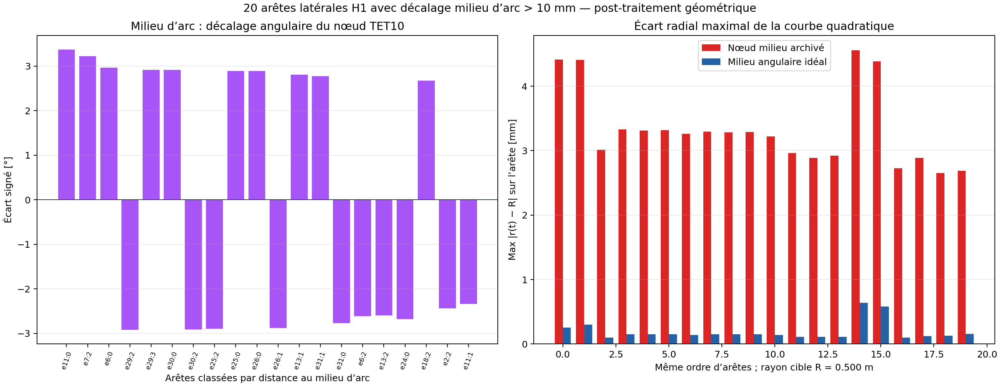

# J24D — clôture du diagnostic H1 et intégration

**Statut :** analyse des maillages et des archives J24B/J24C, correction logicielle E01 isolée. Aucun calcul FEM supplémentaire n’a été lancé. Les statuts J24B/J24C et les échecs historiques restent inchangés.

## Résumé

Les vingt arêtes H1 retenues sont des arêtes latérales du cylindre pour lesquelles le nœud milieu est à plus de 10 mm du milieu angulaire de l’arc court. Les trois nœuds stockés de chaque arête sont sur le rayon cible de 0,5 m à l’arrondi flottant. En revanche, la courbe quadratique TET10 réellement représentée s’écarte du cylindre de jusqu’à 4,558 mm. Avec les mêmes extrémités et un milieu angulaire idéal, son écart maximal est 0,640 mm.

Ces positions sont valides comme données d’interpolation quadratique TET10, mais elles ne décrivent pas la courbure cylindrique avec la précision du mapping idéal à milieu d’arc. Les contrôles de qualité archivés ne révèlent pas de jacobien négatif aux points échantillonnés ; ils ne certifient pas la positivité partout. Les erreurs locales de déplacement et de cisaillement sont des comparaisons descriptives à Saint-Venant et ne démontrent pas que le décalage des nœuds les cause.

Une sensibilité contrôlée de H1 est utile et proportionnée, car le décalage de mapping continu est sensiblement supérieur au cas à milieu idéal. Un contrat court est proposé dans `research/j24d/contracts/proposed_h1_arc_projection_sensitivity.json`. Il n’a pas été exécuté et le scope de lancement reste à enregistrer séparément.

## Baseline, sources et préservation

- `main` contrôlé : `be455745f4a1c2cf81cb9448830223107dc39b66`.
- Branche J24D : `work/0.3.0-j24d`, basée sur le commit J24C `c8a90f6e52bdb6f42444b9ab2e5efe88f478f488`, lui-même descendant de la tête de PR #150 `de3f39c536da73cf43cd19bae58b27a78bb528b2`.
- PR #150 reste ouverte et en brouillon, base `main`, tête exacte `de3f39c536da73cf43cd19bae58b27a78bb528b2`.
- L’analyse a consulté les rapports J24B/J24C, le contrat 002, les maillages/setup archivés H1, le manifeste de l’archive, `warning_edges.csv` et `element_error_comparison.csv`.
- Source du calcul J24B : `275c5788e4eaded1ea4305630ea1b0eb0b88158c`. Empreintes : contrat `1c1b63da996750baf28c7750936d4532ac95644d4ff317344113324e12331e5e`, maillage H1 `05f3db8c38cc2ad580b38a332535f6be25c42ebf0d4fafb424538bbf9183ebef`, setup H1 `409371b02a218d099768f41e256dbb3422ab964fdd623844b0505466024ac8bd`, archive J24B `61a916e5dce3d09804ab2b8110f41eeba4c449257f7ea1f80536c64616dae6ff`.
- Le checkout utilisateur d’origine n’a pas été modifié. Ses changements préexistants et son ajout documentaire staged sont restés en place. Les travaux J24D et E01 sont dans deux worktrees isolés.

## Analyse géométrique des 20 arêtes H1

Le script reconstruit l’interpolation quadratique de Lagrange de chaque arête :
`x(t)=N_0(t)x_0+N_m(t)x_m+N_1(t)x_1`, `0\leq t\leq1`. Il forme ensuite le polynôme quartique `y(t)^2+z(t)^2`, cherche les racines réelles de sa dérivée cubique dans l’intervalle, et évalue les extrémités et points stationnaires. Le résultat quantifie l’écart radial de la courbe d’arête jusqu’à l’erreur d’arrondi du calcul des racines ; il ne certifie ni le volume intérieur du TET10 ni la positivité du jacobien partout.

| Mesure sur les 20 arêtes latérales sélectionnées | Résultat |
|---|---:|
| Distance du milieu stocké au milieu idéal de l’arc court | 20,669–29,775 mm ; médiane 25,242 mm |
| Décalage angulaire du milieu | −2,924° à +3,371° |
| Erreur radiale maximale des trois nœuds stockés | 1,11e−16 m |
| Rayon de la courbe quadratique représentée | 0,495442–0,503568 m |
| Écart radial maximal de la courbe représentée | 4,558 mm (0,912 % de R) |
| Écart maximal du mapping avec milieu angulaire idéal | 0,640 mm (0,128 % de R) |

Le contrôle de qualité J24C compare le nœud milieu à la corde droite et utilise un seuil de 5 %. Il détecte donc une non-linéarité géométrique, mais ne peut pas distinguer une courbure intentionnelle d’un mauvais placement. Toutes les arêtes averties sur les quatre maillages étaient localisées sur le cylindre ou ses rives ; aucune n’était intérieure ou sur une face d’extrémité plane.

Les 20 arêtes sélectionnées touchent 38 éléments distincts. Dans les checkpoints archivés, leur jacobien est positif sur les 35 points d’échantillonnage par élément ; le plus petit `det J` échantillonné parmi ces éléments est 9,966e−3 m³ et le plus petit rapport `min(det J)/max(det J)` est 0,2339. La qualité des tétraèdres définis par les seuls nœuds de coin est au moins 0,3008. Ces contrôles ne bornent pas le jacobien entre les points.

Pour les mêmes éléments propriétaires, l’erreur locale déplacement/Saint-Venant s’étend de 0,259 % à 0,905 %, et l’erreur de cisaillement aux points d’intégration de 1,93 % à 9,51 %. Ce sont des métriques descriptives archivées, sans seuil d’acceptation pour cet échantillon. Elles ne montrent pas, à elles seules, un défaut dû au placement angulaire. L’étude J24C observait aussi une médiane de déplacement comparable entre éléments avertis et non avertis sur H1, mais seulement trois éléments non avertis : ce n’est pas un groupe témoin équilibré.

Le générateur J24B appelle `setOrder(2)` puis `mesh.optimize("HighOrder")`. Les archives établissent le placement des nœuds et la forme du mapping ; elles ne permettent pas d’attribuer leur déplacement à l’optimisation Gmsh.

### Sensibilité proposée, non exécutée

Le contrat proposé compare deux appels sous le même code et le même setup : H1 inchangé, puis H1 où seuls les vingt milieux uniques sont déplacés sur le milieu angulaire, en conservant leur coordonnée axiale stockée et tout le reste du maillage. Il exige un préflight géométrique, les mêmes observables, critères et traces par variante. Il prévoit au plus deux résolutions, une tentative, 600 s de limite souple et 2 GiB RSS souple. Son temps estimé est d’environ 120 s d’après les 75,07 s de la campagne complète J24B ; cette estimation inclut le pré/post-traitement et n’est pas une mesure.

Ce calcul n’est pas autorisé par le présent jalon et ne peut pas réutiliser le scope J24B-002, consommé. Il faudrait un nodeid exact, un worktree/source inventory, un scope Owner enregistré, un préflight et un ledger d’essai propres. Les métriques d’intérêt sont l’angle de torsion, le bilan du couple/résidu, l’énergie et l’erreur de cisaillement IP à maillage/topologie inchangés. Aucun seuil PASS nouveau n’est proposé : les différences seraient d’abord rapportées comme sensibilité exploratoire. Le PASS H1–H4 J24B et les WARNING d’audit restent tels qu’enregistrés.

## PR #150 et diagnostic documentaire

PR #150 est **OPEN / DRAFT**, tête exacte `de3f39c...`, base `main` à `be455745...`, état de fusion `BLOCKED`. Sur cette tête :

| Check | État observé |
|---|---|
| Documentation only diagnostic (informational) | FAILURE, terminé |
| docs-tests | WAITING |
| Ubuntu Python 3.10 / 3.13 | WAITING |
| Windows Python 3.10 / 3.13 | WAITING |

Le check utilise le workflow informatif `pull_request_target`, exécute le script depuis la base approuvée et lit les objets Git candidats comme des données. Le script a une liste blanche stricte : `README.md` et `CITATION_REPORTS.bib`. Le rejeu exact `python scripts/check_documentation_only.py be455745... de3f39c...` échoue sur le premier chemin hors périmètre : `A 'docs/planning/0.3.0-j24b-contract.md'`. Le journal GitHub confirme ce message et le code de sortie 1.

Le comportement correspond à sa configuration : #150 est une PR de preuves mécaniques, pas une PR « documentation uniquement ». Il ne faut ni enlever le contrat/maillage/archive ni élargir la liste blanche à tout le contenu scientifique. Correction adaptée : garder #150 en brouillon, traiter ce check comme « hors périmètre / non applicable » dans la revue, ou ajuster ultérieurement le pilote dans une contribution dédiée pour qu’un diff non documentaire donne un état explicitement neutre/ignoré. Les autres checks restent en attente, pas PASS.

Les verdicts J24B sont préservés : contrat 001 `PYTEST_FAILED`/campagne `INCONCLUSIVE`, contrat 002 `PASS` borné H1–H4, et quatre `WARNING` d’audit général.

## E01 — correction LF et contrôles

La cause est confirmée : le contrôleur de collecte dans `tests/unit/conftest.py` hash les octets bruts via `Path.read_bytes()`. La configuration Git globale active `core.autocrlf=true`, alors qu’aucun attribut ne fixait les deux sources E01 en LF. Les sources contrôleur étaient CRLF et échouaient à l’empreinte approuvée ; après normalisation LF, leurs empreintes correspondent exactement à celles déjà approuvées. Le contenu logique du code n’a pas changé.

Un correctif isolé depuis `main` ajoute dans `.gitattributes` uniquement :
- `tests/unit/test_wp_e01m_hencky_material_point.py text eol=lf`
- `tests/unit/test_wp_e01q_hencky_tangent.py text eol=lf`

Les empreintes et le garde restent inchangés. SHA bruts vérifiés : E01M `cdd2651e9427c0e64284a75671d83d4f14cdd916a979759be0422f44dde84bfc`, E01Q `a99bcc6ea32bff3e2a669d2923380033f23e587aab95f612ab4047f98b7d7b50`. Les deux nodeids exacts ont été exécutés séparément : `1 passed` chacun.

Le contrôleur de développement n’a pas été utilisé pour ces essais : l’entrée E01 de `development_autonomous_policy.json` référence un ancien worktree absent et une branche différente. Les tests ciblés ont été exécutés directement dans un worktree propre basé sur `main`; ils passent par le garde `conftest.py`, mais ne produisent pas de ledger ni de provenance du runner. Pour un futur lancement enregistré, il faudra une entrée de policy alignée sur un worktree actif plutôt que modifier l’identité E01 existante.

Le correctif a été commité sur `fix/e01-hash-bound-line-endings`, commit `0843df3330055c493ef4117535e95954915b4ea1`, et proposé en PR brouillon [#151](https://github.com/emptiesvoid-cloud/QF_solver/pull/151), base `main`. Sur cette tête, le contrôle documentaire échoue aussi de façon attendue car `.gitattributes` est hors périmètre ; les cinq autres checks étaient `WAITING`. #151 reste brouillon pendant ses checks.

## Reproductibilité et intégration

- L’analyse J24D se régénère avec `python research/j24d/h1_edges/analyze_h1_arc_offsets.py`, depuis une base qui contient les entrées J24B (#150) et résultats J24C. Environnement observé : Python 3.13.1, NumPy 2.2.6, Matplotlib 3.10.3.
- Le script confirme les empreintes du contrat, maillage, setup et CSV J24C avant de produire JSON, CSV et PNG.
- Les fins de ligne du contrat/setup J24B et des CSV sources J24C sont épinglées en CRLF pour préserver leurs empreintes historiques brutes ; les sources et sorties textuelles J24D sont épinglées en LF et le script écrit en LF. Cela évite que `core.autocrlf` change la provenance selon la plateforme.
- Pour reproduire un solveur FEM J24B depuis `main`, il manque le contrat, le test de reproduction, les maillages/setup et les sorties brutes apportés par #150. Les sources de production qui définissent le diagnostic géométrique sont déjà sur `main`. Une nouvelle variante H1 demande un nouveau scope ; le scope J24B-002 est consommé.
- #150 doit conserver son SHA et son périmètre J24B tant que ses checks attendent. J24C/J24D sont des artefacts dépendants ; leur contribution est empilée sur la branche de tête de #150 dans une PR brouillon distincte. Après intégration de #150, cette contribution pourra être retargetée à `main`. Aucune PR n’est fusionnée dans J24D.

## Fichiers J24D

- Analyse : `research/j24d/h1_edges/analyze_h1_arc_offsets.py`, SHA-256 `D1297D65FC8FFD79FFE5981F0737CE541B24C9352D512378C864E6BA3D805E6D`.
- Résultats JSON : `research/j24d/results/diagnostic-2026-11-18/h1_edge_geometry.json`, SHA-256 `EEBBA91967581F1D24439B497FCA0DE55EA32D8454A5700271F2CA5D1A322136`.
- Détails CSV : `research/j24d/results/diagnostic-2026-11-18/h1_edge_geometry.csv`, SHA-256 `62D35BB1E02666DBF4905270BF5ED190EFDEC4D0093EF46B6BDDCBCCDB0641AC`.
- Figure : `research/j24d/results/diagnostic-2026-11-18/h1_edge_radial_deviation.png`, SHA-256 `6BD135EE089C163CFF6507C59DF2B519D5ED079A1747D39BDD81A159C09EF735`.

## Modèles candidats pour le jalon suivant

| Candidat | Diversité | Route et référence observées | Coût estimé | Limite principale |
|---|---|---|---|---|
| **Colonne solide TET10 en flambement linéaire sous compression** | Nouvelle famille d’analyse stabilité ; géométrie différente de l’arbre torsion et des plaques/coques récentes. | `LinearBucklingSolver` accepte les TET10 homogènes isotropes avec précharge proportionnelle nodale ; les tests contiennent une ligne de recherche interne TET10/HEX20. Le benchmark Euler de colonne disponible porte sur TET4 seulement ; aucune corrélation Euler-TET10 n’a été trouvée. La formule reste une référence analytique indépendante à rendre compatible avec le solide. | Moyen, estimation qualitative : précharge non linéaire, tangente géométrique, problème propre clairsemé et quelques niveaux de maillage. | La route est explicitement `research`, premier facteur tangent seulement ; Euler suppose une poutre élancée, et les appuis/effets d’extrémité du solide doivent être cohérents. Aucun post-flambement ni qualification globale. |
| Arbre BEAM2 à disque rigide en rotation, séparation gyroscopique des modes | Nouvelle physique rotor et représentation Campbell/whirl. | Route QEP/Campbell existante, mais `EXPERIMENTAL`. Oracle analytique GYRO-05 vérifie l’oscillateur/disque, pas à lui seul la corrélation complète de l’arbre maillé. | Moyen à élevé, estimation qualitative : faible taille numérique, mais contrat et référence indépendante du système shaft/disk à bâtir. | Limité à un arbre droit circulaire, disque centré axisymétrique, petit mouvement non amorti/non précontraint. |
| Cadre BEAM2 plan sous charge combinée | Faible diversité de famille ; sollicitation statique différente. | BEAM2 et corrélation Code_Aster/POU_D_E sont déjà disponibles. | Faible à moyen, estimation qualitative. | Apporte moins que les modèles solides/stabilité ; route et benchmark restent expérimentaux/bornés. |

**Recommandation :** lancer ensuite un cas de flambement linéaire d’une colonne solide TET10, avec un chargement et des appuis explicitement appariés à la formule d’Euler d’une colonne élancée. C’est la meilleure combinaison de nouvelle famille d’analyse, route TET10 effectivement présente et oracle analytique indépendant. Commencer par un petit contrat exploratoire et vérifier la précharge/appui avant une campagne de raffinement. Ne pas réutiliser ni requalifier les FAIL historiques HEX8 buckling ; le candidat TET10 resterait borné et de maturité recherche.

## Contrôles réalisés

- Rejeu complet du post-traitement d’arêtes H1 et production du JSON/CSV/PNG.
- `python -m py_compile research/j24d/h1_edges/analyze_h1_arc_offsets.py` réussi.
- PR #150 : contrôles récupérés sur le SHA exact, documentation classifier reproduit et échoue de façon attendue hors périmètre.
- E01 : vérification des attributs EOL et SHA approuvés ; deux tests unitaires exacts ont passé séparément.
- Aucun test FEM, aucune exécution Gmsh ni solveur externe, aucune campagne FEM dans J24D.
