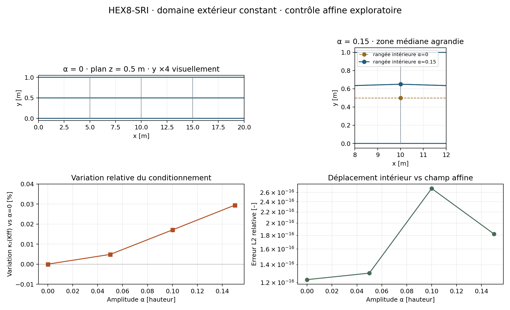
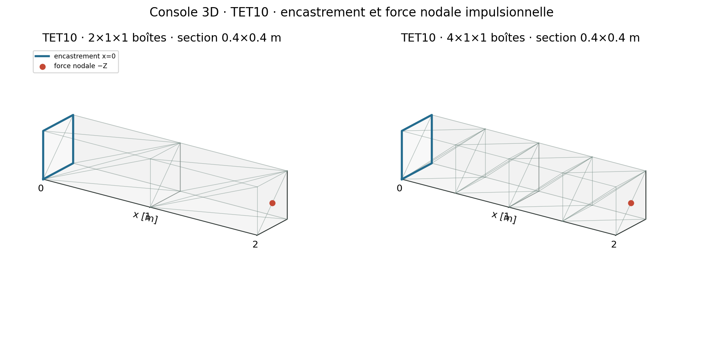
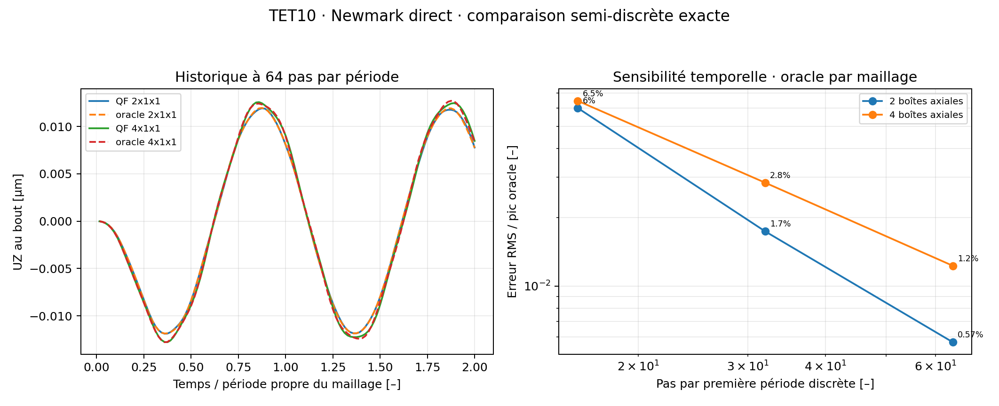

# QF Solver 0.3.0 — J9 : diagnostic HEX8-SRI et premier transitoire TET10

**Statut :** diagnostics de développement exploratoires. Ils ne qualifient pas le solveur et ne changent aucun verdict historique.

## 1. Baseline et traçabilité

- `main` vérifié après `git fetch origin main` : `be455745f4a1c2cf81cb9448830223107dc39b66`.
- J8, branche de départ fondée sur ce `main` : `work/0.3.0-j8@737538d8a72e2a5d55d1bfc7a37b09d3e8a44776`.
- Branche de travail isolée : `work/0.3.0-j9`, descendante directe de J8.
- PR #136 reste ouverte en brouillon, base `main`, tête `work/0.3.0-j8`.
- Le checkout utilisateur préexistant n’a pas été modifié.

Les contrats et le runner J9 ont été gelés dans `a8f5a91653c50c51cb51e51b297ed9c2cd623362`. Le balayage HEX8 a été calculé sur ce commit. Après l’échec de la route modale, une hypothèse directe seule a reçu un contrat, un nodeid et un commit distincts `88cd0b1cd51d2eb708afd881c3f8130f59a31f1e`. Les identifiants et empreintes des préflights, exécutions et sources figurent dans les reçus assainis sous `research/j9/results/diagnostic-2026-11-16/`.

La politique locale ignorée impose un préflight exact, un thread numérique et une tentative par nodeid. Les seuils de mémoire, nombre de processus, fichiers temporaires et archive sont surveillés par échantillonnage; le timeout et les plafonds de sortie capturée sont appliqués par le runner. Les FAIL J7 conservés par J8 restent inchangés.

## 2. Axe A — HEX8-SRI, distorsion intérieure à domaine constant

### Contrat et modèle

Le contrat `research/j9_hex8/contracts/hex8_constant_domain_distortion_contract.json` fixe un bloc `20 × 1 × 1 m`, matériau `E=1 MPa`, `ν=0,495`, HEX8-SRI sur `4 × 2 × 2` éléments (45 nœuds, 16 éléments). Les neuf degrés de liberté des trois nœuds intérieurs sont libres. Chaque nœud de bord reçoit le déplacement affine prescrit `ux=εx`, `uy=−νεy`, `uz=−νεz`, avec `ε=10⁻⁴`; il n’y a pas de charge nodale extérieure.

La transformation déplace seulement les nœuds intérieurs selon une bulle lisse, pour `α=0; 0,05; 0,10; 0,15`. Elle laisse inchangés le domaine extérieur, la connectivité, le matériau et le champ physique prescrit. Le volume intégré par les jacobiens reste `20 m³`. Les déterminants de Gauss restent positifs, avec un minimum qui passe de `0,15625` à `0,12123 m³`.

La référence indépendante est le champ affine homogène d’élasticité 3D en traction uniaxiale : `σxx=Eε=100 Pa`, résultante axiale `±100 N` et énergie `0,1 J`. Le script assemble directement la matrice HEX8-SRI et résout le petit système réduit par NumPy. Cette vérification est un patch affine à neuf DDL libres, pas une comparaison externe du solveur global.

### Résultats

| α | `κ₂(Kff)` | Erreur déplacement L2 relative | Énergie relative `U` | Réaction x gauche / droite |
|---:|---:|---:|---:|---:|
| 0,00 | 43,50149 | `1,23e−16` | `−4,30e−15` | `−100,000 / +100,000 N` |
| 0,05 | 43,50360 | `1,30e−16` | `+1,94e−14` | `−100,000 / +100,000 N` |
| 0,10 | 43,50891 | `2,69e−16` | `−1,94e−14` | `−100,000 / +100,000 N` |
| 0,15 | 43,51428 | `1,82e−16` | `−1,68e−14` | `−100,000 / +100,000 N` |

Le conditionnement augmente de `0,0294 %` entre les extrêmes; l’écart au champ affine est au niveau de l’arrondi. Les résultantes et l’énergie retrouvent la référence dans la précision numérique observée. Aucun seuil d’acceptation mécanique n’a été fixé : le node runner `PASS` signifie que le diagnostic et ses invariants structurels se sont exécutés.

Ce résultat **n’explique pas** les échecs J7. Leur conditionnement (`4,36e9` et `1,51e10` rapportés par J8), le chargement et les contraintes du modèle diffèrent; le diagnostic J9 a une géométrie régulière, des déplacements prescrits affines et seulement neuf DDL libres. Il indique seulement que cette bulle de distorsion modérée ne dégrade pas ce patch précis.

### Recalcul du système réduit, travail et énergie

Un post-traitement distinct, contracté après les calculs FEM, a repris les matrices `K` et états archivés sans réassemblage. Pour chacun des quatre niveaux, il a reconstruit `Kff·uf = −Kfc·uc` et comparé `numpy.linalg.solve` à `scipy.linalg.cho_solve` sur les mêmes neuf DDL libres. L’écart relatif entre les deux solutions est de `1,30e−16` à `2,39e−16`; les résidus libres valent `6,43e−13` à `2,98e−12 N`. Les réactions reconstruites diffèrent de celles archivées de moins de `3,64e−12 N`.

Le travail de contrôle est défini comme `0,5·u_bᵀ·(K·u)_b`, pour une rampe linéaire depuis zéro des déplacements de bord prescrits. Il vaut environ `0,1 J`, comme `U=0,5·uᵀ·K·u`; l’indicateur relatif `|U−W|/max(|U|,|W|)` va de `4,58e−15` à `1,30e−14`. La référence continue vaut également `0,1 J`. Cette identité est cohérente pour ce problème élastique linéaire et cette convention de travail; elle ne définit pas un critère général pour d’autres types de chargement.

Ce contrôle compare deux solveurs directs sur la même matrice archivée; il ne constitue ni une formulation indépendante ni une validation du solveur global. Deux exécutions logicielles initiales ont échoué sur des noms de champs du contrat, d’abord avant les résolutions, puis après huit résolutions en mémoire mais avant l’écriture JSON. Les deux incidents sont archivés séparément; la troisième tentative, contractée après correction et contrôle de schéma, a produit le résultat ci-dessus. Pour la première erreur, le SHA du script transitoire n’avait pas été enregistré avant son édition; le reçu le marque explicitement `null`. Cette lacune ne touche pas les données FEM archivées ni les résultats de la troisième tentative. Aucun résultat FEM ni verdict historique n’a été remplacé.

L’échelle transverse du schéma de plan est amplifiée visuellement par quatre pour montrer la bulle; les axes donnent les unités physiques. Les fichiers calculés originaux et l’état NPZ restent également conservés.

## 3. Axe B — Cantilever TET10 et Newmark direct

### Modèle et référence

Le solide mesure `2 × 0,4 × 0,4 m`; matériau isotrope `E=70 GPa`, `ν=0,30`, `ρ=2700 kg/m³`, unités SI, masse cohérente TET10. Le plan complet `x=0` est fixé en translation. Une force nodale triangulaire `−1 N` selon `Z` agit au nœud central de la face `x=L`, qui sert aussi de mesure `UZ` en `(2; 0,2; 0,2) m`. Les conditions initiales sont nulles, l’amortissement de Rayleigh nul et Newmark utilise `β=0,25`, `γ=0,5`.

Les deux maillages sont des subdivisions conformes de boîtes en six tétraèdres linéaires, enrichies en TET10 : `2×1×1` (12 éléments, 45 nœuds, 108 DDL libres) et `4×1×1` (24 éléments, 81 nœuds, 216 DDL libres). Le raffinement ne porte que sur `x`; la section ne comporte qu’une boîte dans chaque direction transverse.

La référence temporelle `PiecewiseLinearModalOracle` diagonalise le même système semi-discret `M,K` assemblé par `GlobalAssembler`, puis propage exactement chaque intervalle de charge affine par exponentielle de matrice. Elle ne réutilise pas la récurrence Newmark et conserve tous les modes. Elle vérifie l’intégration temporelle **pour les matrices et le chargement assemblés**; elle ne valide pas l’assemblage TET10 par rapport à un solveur externe ni l’erreur spatiale par rapport au continuum.

### Limite de la tentative modale et reprise directe

La première tentative, sous le contrat `tet10_newmark_transient_contract.json`, a terminé les trois pas de temps directs du maillage grossier, puis la validation de la base modale complète a levé `ModalResidualValidationError: reason=aggregate_work_budget` à 108 DDL. Le maillage fin n’a pas été traité; aucun état ni métrique finale n’a été sérialisé. Son statut d’exécution reste `PYTEST_FAILED`. Ce n’est pas un FAIL mécanique ou un résultat modal calculé.

Conformément à la règle d’une tentative par nodeid, ce run n’a pas été rejoué. Le contrat direct distinct `tet10_newmark_direct_contract.json`, gelé avec le commit `88cd0b1c`, exécute seulement la route directe sur les deux maillages et conserve les données. La route modale complète n’a pas de résultat J9; aucun essai modal tronqué ni aucune étude de troncature n’a été réalisé.

### Pas de temps et sensibilités

Chaque mesh reçoit un triangle de charge de durée `T₁/4`, avec son propre premier mode semi-discret. Les pas valent `T₁/16`, `T₁/32` et `T₁/64`; la durée simulée vaut `2T₁`. La durée physique de l’impulsion change donc de `2,919 ms` à `3,025 ms` entre les deux maillages. Les comparaisons de fréquence sont des indicateurs spatiaux propres, mais les amplitudes des historiques des deux maillages ne représentent pas exactement le même chargement physique.

| Maillage | `f₁` semi-discrète | Erreur RMS normalisée oracle à 16 / 32 / 64 pas par période | Ordres observés 16→32 / 32→64 |
|---|---:|---:|---:|
| `2×1×1` | `85,6469 Hz` | `6,019 % / 1,736 % / 0,569 %` | `1,79 / 1,61` |
| `4×1×1` | `82,6433 Hz` | `6,468 % / 2,834 % / 1,228 %` | `1,19 / 1,21` |

La fréquence baisse de `3,51 %` entre les deux niveaux (soit un incrément de `3,63 %` rapporté à la fréquence fine). Les erreurs temporelles diminuent avec le pas sur chaque système semi-discret, mais les ordres ne sont pas monotones vers deux et restent descriptifs. Le contrôle d’énergie totale après extinction de la charge varie d’environ `1e−12` relatif; le résidu dynamique absolu maximum archivé est inférieur à `1e−12 N`. Ces valeurs sont cohérentes avec les résolutions effectuées, sans constituer des seuils de qualification.

La force assemblée est exactement `(0,0,−1) N`; les volumes de coin sont positifs (`0,026667 m³` et `0,013333 m³`). Le maximum de `|UZ|` à 64 pas vaut `0,01192 µm` et `0,01278 µm` respectivement. Comme la durée de l’impulsion suit `T₁` de chaque mesh, cette différence d’amplitude ne doit pas être attribuée au seul raffinement.

Code_Aster et CalculiX ne sont pas disponibles pour une corrélation dans cet environnement : la commande Docker existe, mais le daemon Linux échoue faute de canal `dockerDesktopLinuxEngine`; ni `as_run` ni `ccx` n’est installé. Aucune donnée externe n’a été inventée. Un rapport antérieur documente une autre corrélation TET10/Code_Aster, mais elle ne constitue pas une référence pour ce chargement précis.

Les NPZ contiennent les maillages, opérateurs réduits `M,K` et historiques du point de mesure, mais pas les déplacements nodaux complets à chaque instant. Aucune animation de déformée n’a donc été créée; les courbes représentent bien les états calculés.

## 4. Procédure et ressources

Les trois familles de calcul ont chacune un contrat. Budgets runner : 1 200 s, RSS souple 2 048 MiB, quatre processus, 8 MiB de sortie totale / 4 MiB par flux, 256 MiB temporaires, 128 MiB d’archive, un thread numérique; le préflight requiert 1 GiB d’espace libre. Chaque préflight collect-only a passé et n’a exécuté aucun corps de test.

| Exécution | Statut | Temps | Pic RSS | Processus max. | Archive / temporaire |
|---|---|---:|---:|---:|---:|
| Préflight HEX8 | `PREFLIGHT_PASS` | 3,98 s | 105,1 MiB | 1 | 578 / 0 B |
| HEX8 domaine constant | `PASS` exploratoire | 5,17 s | 121,8 MiB | 1 | 221 861 / 0 B |
| Préflight TET10 modal | `PREFLIGHT_PASS` | 5,17 s | 151,9 MiB | 1 | 574 / 0 B |
| TET10 direct + modal | `PYTEST_FAILED` route modale | 9,41 s | 157,9 MiB | 1 | 7 112 / 0 B |
| Préflight TET10 direct | `PREFLIGHT_PASS` | 5,19 s | 149,5 MiB | 1 | 564 / 0 B |
| TET10 direct seulement | `PASS` exploratoire | 16,49 s | 170,5 MiB | 1 | 485 634 / 0 B |

Le contrôle unitaire explicite `test_j9_scope_is_bound_to_exact_nodes_one_thread_and_private_namespace` a passé avant et après l’extension au nodeid direct seul. La compilation Python ciblée et le contrôle de schéma du post-traitement ont passé. Aucun autre test ni campagne FEM n’a été lancé. Le post-traitement HEX8 final a pris `0,0216 s` mesurées dans le script, un processus, pic RSS échantillonné `60 628 992 B` (environ `57,8 MiB`), zéro octet temporaire.

## 5. Git, confidentialité et suite

Les reçus de runner bruts restent dans le stockage local ignoré parce qu’ils contiennent les racines de worktree. Les copies suivies contiennent contrats, résultats bruts nécessaires, matrices et états NPZ, courbes, figures, reçus assainis et manifeste SHA-256. Les scans de confidentialité excluent les chemins de profil et journaux bruts. Aucune release, étiquette, publication de site ou fusion n’a eu lieu.

Le prochain travail recommandé est un lot séparé qui compare le transitoire à un solveur indépendant sur exactement le même TET10, le même `M,K`, le même chargement physique et les mêmes temps, puis affine aussi la section transverse. En parallèle, reprendre HEX8-SRI avec un cas qui ressemble davantage au système J7 tout en gardant le domaine physique constant; le présent patch affine n’isole pas la cause des FAIL historiques.
