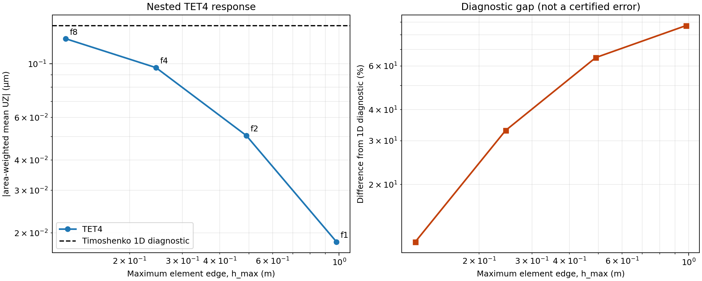
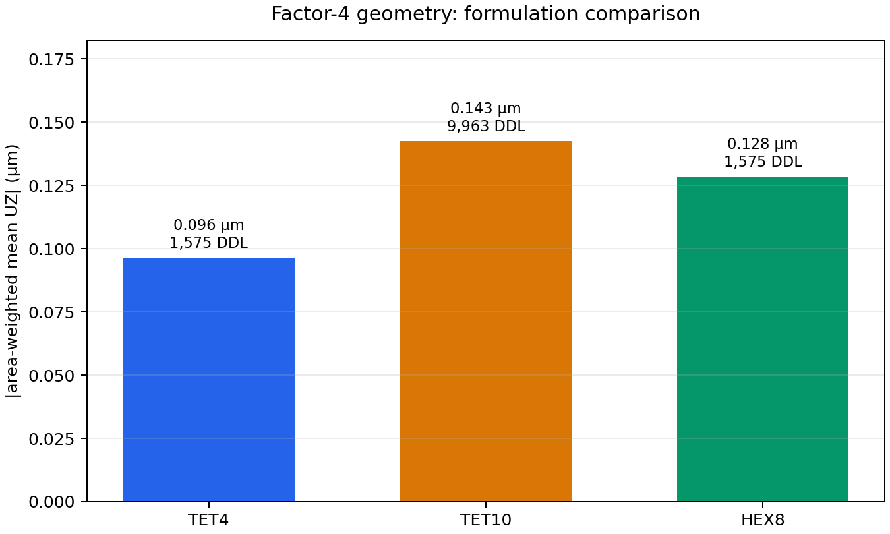
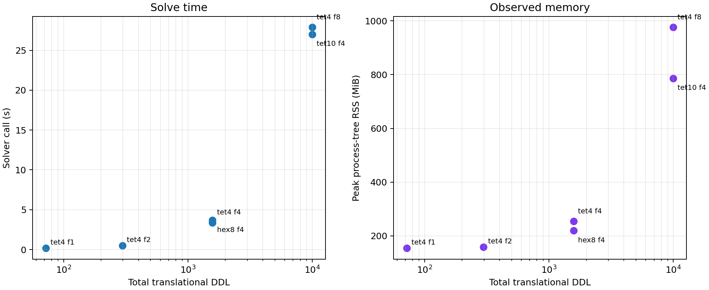

# WP12 TET4 — synthèse de convergence et comparaison mécanique

## Portée et statut

Cette synthèse exploite uniquement les six exécutions FEM déjà archivées. Elle ne lance aucun calcul. Les sources sont le commit scientifique `619fddd97d56936ca3333cbeca9e7ae46dbd6a8e`, les six fichiers `mechanics.json`, leurs vecteurs `displacement.npy`, les six `run.json` du contrôleur et l’analyse initiale `analysis-20261026-v1` sous `E:\QFSolverAgents\evidence\tet4\fem-cases-wp12-v1`.

Les six tentatives ont terminé `PASS`, chacune avec un cas FEM, une route directe, au plus 9 963 DDL, un délai maximal autorisé de 900 s et une RSS observée sous la limite souple de 4 096 MiB. Les six vecteurs de déplacement sont finis et leur longueur correspond aux DDL déclarés. Ces constats établissent l’exécution et la cohérence numérique de ces cas précis; ils ne constituent pas une qualification du solveur ni une validation générale de TET4.

## Couverture des sept cas demandés

Les sept rôles initiaux ne requièrent que six résolutions distinctes. Le TET4 F4 de raffinement couvre aussi le rôle de référence TET4 F4 en route directe : le test `test_wp12_tet4_refinement_factor_4` charge le modèle préparé avec `analysis.method == "direct"`, le test vérifie que le modèle TET4 de la séquence est identique au modèle TET4 de comparaison (géométrie, connectivité, appuis, charges, matériau et route), et le résultat archivé rapporte `method=direct`, `converged=true`. L’enregistrement du résultat porte les deux rôles `refinement` et `family_comparison_TET4_baseline`. Un second F4 direct serait redondant et n’ajouterait pas d’information scientifique.

| Rôle demandé | Nodeid exécuté | DDL | Statut |
|---|---|---:|---|
| TET4 F1 | `tests/unit/test_wp12_tet4_prepared_fem.py::test_wp12_tet4_refinement_factor_1` | 72 | PASS |
| TET4 F2 | `tests/unit/test_wp12_tet4_prepared_fem.py::test_wp12_tet4_refinement_factor_2` | 297 | PASS |
| TET4 F4 raffinement | `tests/unit/test_wp12_tet4_prepared_fem.py::test_wp12_tet4_refinement_factor_4` | 1 575 | PASS; couvre également le TET4 F4 direct de comparaison |
| TET4 F8 | `tests/unit/test_wp12_tet4_prepared_fem.py::test_wp12_tet4_refinement_factor_8` | 9 963 | PASS |
| TET4 F4 route directe, comparaison | Même nodeid TET4 F4 ci-dessus | 1 575 | Couvert par le calcul TET4 F4 déjà exécuté; aucun calcul distinct |
| TET10 F4 | `tests/unit/test_wp12_tet4_prepared_fem.py::test_wp12_tet10_family_comparison_factor_4` | 9 963 | PASS |
| HEX8 F4 | `tests/unit/test_wp12_tet4_prepared_fem.py::test_wp12_hex8_family_comparison_factor_4` | 1 575 | PASS |

Les quatre niveaux TET4 utilisent des maillages imbriqués de qualité géométrique constante. Les comparaisons de famille gardent les mêmes dimensions, matériau, appui, résultante et moment appliqués. Elles ne sont toutefois pas des séquences de convergence propres à TET10 ou HEX8.

## Convergence TET4

Le déplacement indiqué est la moyenne surfacique de `UZ` sur la face chargée; avec le chargement surfacique consistant, il coïncide avec le déplacement conjugué au travail. Les valeurs sont négatives dans le sens de la charge.

| Niveau | Cellules | TET4 | Nœuds / DDL | `h_max` (m) | `UZ` moyen (µm) | Hausse de `|UZ|` depuis le niveau précédent | Écart au diagnostic Timoshenko 1D |
|---:|:---:|---:|---:|---:|---:|---:|---:|
| F1 | 5×1×1 | 30 | 24 / 72 | 0,979796 | −0,018373 | — | 87,238 % |
| F2 | 10×2×2 | 240 | 99 / 297 | 0,489898 | −0,050578 | 175,284 % | 64,870 % |
| F4 | 20×4×4 | 1 920 | 525 / 1 575 | 0,244949 | −0,096484 | 90,764 % | 32,984 % |
| F8 | 40×8×8 | 15 360 | 3 321 / 9 963 | 0,122474 | −0,127058 | 31,688 % | 11,748 % |

La souplesse mesurée augmente à chaque raffinement; l’écart relatif entre niveaux diminue après F2, mais l’incrément absolu n’est pas encore régulier. Les différences successives de `|UZ|` valent 0,032205, 0,045906 et 0,030574 µm. Pour un pas de taille divisé par deux, l’indicateur basé sur les différences `p_app = log₂(Δ_coarse/Δ_fine)` donne −0,511 pour les paires F1–F2/F2–F4, puis 0,586 pour F2–F4/F4–F8. Le premier indicateur négatif et le second encore variable montrent que la séquence ne démontre pas un régime asymptotique; ces nombres ne sont pas un ordre de convergence fiable.

Le diagnostic Timoshenko 1D vaut −0,143971 µm. F8 reste 11,748 % plus raide que ce diagnostic. Cette comparaison suggère que F8 est plus proche que F1–F4, mais le diagnostic 1D n’est pas une solution exacte de la géométrie 3D, de la traction de face et de l’encastrement modélisés ici. On ne peut donc pas en déduire l’erreur physique de F8 ni extrapoler un déplacement limite.

### Qualité géométrique

Sur les quatre niveaux TET4, le minimum et le 5e percentile de `6√2 V / rms_edge³` sont `0,402845`; sa moyenne est `0,468900`, sa médiane `0,501928` et son 95e percentile `0,501928`. Le rapport d’aspect médian est `2,449490`; le rapport du déterminant jacobien minimal vaut 1. Les six maillages ensemble ont zéro élément invalide/fatal et zéro avertissement qualité. La similitude de ces métriques indique que la tendance de déplacement n’est pas accompagnée d’une dégradation des formes d’éléments.

## Comparaison TET4 / TET10 / HEX8 à F4

| Formulation | Éléments | Nœuds / DDL | `UZ` moyen (µm) | Écart de `|UZ|` au TET4 F4 | Temps solveur (s) | RSS max observée (MiB) |
|---|---:|---:|---:|---:|---:|---:|
| TET4 | 1 920 | 525 / 1 575 | −0,096484 | référence | 3,390 | 253,6 |
| TET10 | 1 920 | 3 321 / 9 963 | −0,142520 | +47,714 % | 27,009 | 786,2 |
| HEX8 | 320 | 525 / 1 575 | −0,128364 | +33,042 % | 3,680 | 219,6 |

TET10 est 11,028 % plus souple que HEX8 sur ces trois cas. TET10 F4 et TET4 F8 ont le même nombre de DDL, et TET10 F4 donne `|UZ|` supérieur de 12,170 % à TET4 F8; cette comparaison n’a pas la même partition ni le même ordre polynomial. Elle décrit les résultats de ces discrétisations, pas une supériorité générale d’une famille. Les métriques de distorsion ont des définitions propres aux familles et ne sont pas comparables entre elles.

## Cohérence mécanique et algébrique

La résultante appliquée est `(0, 0, −1) N` et son moment à l’origine `(-0,2, 4,0, 0) N·m`. Les réactions sont proches de `(0, 0, +1) N` et `(0,2, −4,0, 0) N·m`. Sur les six cas, les maxima archivés sont :

- erreur relative de fermeture des forces : `2,431×10⁻¹⁰`;
- erreur relative de fermeture des moments : `1,788×10⁻¹⁰`;
- résidu libre normalisé `||r_free||₂ / ||F_free||₂` : `3,559×10⁻¹⁰`;
- erreur d’identité énergie-travail `|2U − W| / |W|` : `4,500×10⁻¹¹`;
- différence entre le déplacement moyen de face et le déplacement conjugué au travail : `3,970×10⁻²³ m`.

La normalisation du résidu ci-dessus est distincte de celle de l’audit interne, `||r_free||₂ / max(||F_free||₂, 1 N)`. Les résultats indiquent une bonne cohérence algébrique du système assemblé et des bilans globaux. Ils ne mesurent pas l’erreur de discrétisation par rapport à la solution 3D.

Les six métadonnées solveur indiquent la route directe et `converged=true`. Le résidu relatif solveur est inférieur à la tolérance enregistrée de `1e−7` dans chaque cas. Ceci établit la convergence algébrique des résolutions exécutées; cela ne démontre pas la convergence spatiale ni la précision physique.

| Cas | Réaction `Rz` (N) | Réaction `My` (N·m) | Fermeture forces | Fermeture moments | `||r_free||₂ / ||F_free||₂` | `U` (J) | `W` (J) | `|2U−W|/|W|` | Solveur (s) | RSS (MiB) |
|---|---:|---:|---:|---:|---:|---:|---:|---:|---:|---:|
| TET4 F1 | 1,000000 | −4,000000 | 2,0701e−13 | 1,4805e−13 | 7,4834e−13 | 9,1865e−09 | 1,8373e−08 | 3,5477e−14 | 0,18 | 154,3 |
| TET4 F2 | 1,000000 | −4,000000 | 3,3621e−12 | 2,0880e−12 | 7,1643e−12 | 2,5289e−08 | 5,0578e−08 | 2,9765e−13 | 0,49 | 158,3 |
| TET4 F4 | 1,000000 | −4,000000 | 1,9793e−11 | 1,7415e−11 | 6,2640e−11 | 4,8242e−08 | 9,6484e−08 | 1,2195e−11 | 3,39 | 253,6 |
| TET4 F8 | 1,000000 | −4,000000 | 2,4305e−10 | 1,7880e−10 | 3,4181e−10 | 6,3529e−08 | 1,2706e−07 | 4,4995e−11 | 27,88 | 976,0 |
| TET10 F4 | 1,000000 | −4,000000 | 7,6064e−11 | 4,9007e−11 | 3,5592e−10 | 7,1260e−08 | 1,4252e−07 | 2,9889e−11 | 27,01 | 786,2 |
| HEX8 F4 | 1,000000 | −4,000000 | 2,1293e−11 | 1,6575e−11 | 3,1219e−11 | 6,4182e−08 | 1,2836e−07 | 5,5107e−12 | 3,68 | 219,6 |

Le détail machine-readable des six cas est conservé dans [`case_metrics.csv`](case_metrics.csv) et [`summary.json`](summary.json). Les vecteurs et journaux bruts d’origine restent dans l’archive de preuves citée en tête du rapport.

## Coûts observés

Le temps maximal d’une tentative complète est 36,69 s (TET10 F4); la RSS maximale mesurée est 976,0 MiB (TET4 F8), contre une limite souple de 4 096 MiB. Le temps solveur va de 0,182 s (TET4 F1) à 27,884 s (TET4 F8). Les coûts sont ceux de cette machine et de ces exécutions uniques; ils ne constituent pas une loi de performance validée.

## F16 et référence 3D indépendante

Le schéma F16 conserverait les cellules `(80, 16, 16)`, soit 23 409 nœuds, 122 880 TET4 et 70 227 DDL. Il dépasserait donc le plafond actuellement inscrit de 50 000 DDL de 20 227 DDL (40,5 %). La campagne a consommé 6 tentatives sur 12, mais la limite DDL exclut F16 sous la configuration actuelle.

À titre d’ordre de grandeur seulement, de F4 à F8 la RSS observée a été multipliée par 3,85 et le temps solveur par 8,23. Répéter ces facteurs une fois donnerait environ 3 756 MiB et 229 s de solveur pour F16, c’est-à-dire une mémoire très proche de la limite souple de 4 096 MiB. Une seule transition mesurée ne permet pas une prédiction robuste; le risque de dépassement mémoire est significatif. Ce calcul n’a pas été lancé.

Une référence 3D indépendante apporterait plus d’information que F16 seul. La suite la plus discriminante serait de reproduire la géométrie, le matériau, les conditions aux limites et surtout la distribution de charge dans un second solveur de solides 3D, puis d’y établir sa propre convergence sur le même déplacement moyen de face, les réactions, les moments et l’énergie. Les documentations publiques de Code_Aster donnent un catalogue de cas de validation mécanique et des documents de référence; un cas générique de ce catalogue ne remplacerait toutefois pas la reproduction exacte du chargement WP12. [Catalogue V3 de validation Code_Aster](https://code-aster.org/doc/v15/V3.html), [références théoriques Code_Aster](https://code-aster.org/doc/v15/R.html).

## Conclusion et recommandation

Les sept rôles demandés sont couverts par six calculs distincts; le TET4 F4 direct est déjà le calcul F4 de raffinement et le baseline TET4 du comparatif. Il ne faut pas ajouter un septième calcul identique. La cohérence algébrique est excellente, la qualité des maillages est constante et la réponse TET4 s’approche du diagnostic 1D, mais l’indicateur d’ordre est instable et aucune référence 3D indépendante n’est disponible. La précision physique TET4 n’est donc pas quantifiée et aucune qualification formelle n’est établie.

**Recommandation : clôturer cette campagne exploratoire.** Ne pas lancer F16 sous le plafond DDL actuel. Si une expérience supplémentaire est ultérieurement autorisée, privilégier d’abord une référence 3D indépendante, avec une définition identique des observables et un critère de convergence fixé avant calcul; un raffinement F16 n’aurait de sens qu’après levée explicite du plafond et confirmation d’une marge mémoire suffisante.

## Inscriptions du contrôleur

La copie de travail commune contenait six `allowed_nodeids` et six `nodeid_registration_records`, tous liés au HEAD `619fddd97d56936ca3333cbeca9e7ae46dbd6a8e`, au fingerprint `eb29d0c88cd5be1fb238b8472b1bf3b970f5aa2a743ecc8fca7a6a44e54b87df` et au délai de 900 s. Les six nodeids sont ceux du tableau de couverture. Au moment de cette synthèse, ils n’étaient pas encore stabilisés dans le commit d’intégration : le worktree commun `E:\QFSolverAgents\wp12-policy-final` était sur `codex/wp12-policy-finalization` au commit `4bf52792f46988b84fecf11ebe3bd5fe078975ef`, avec `development_autonomous_policy.json` modifié; le commit intégré `b0023628d7231629cc6bf124420e995fffa6c44c` ne contenait pas les six inscriptions. Je n’ai apporté aucune modification à la politique commune ni au runner.
