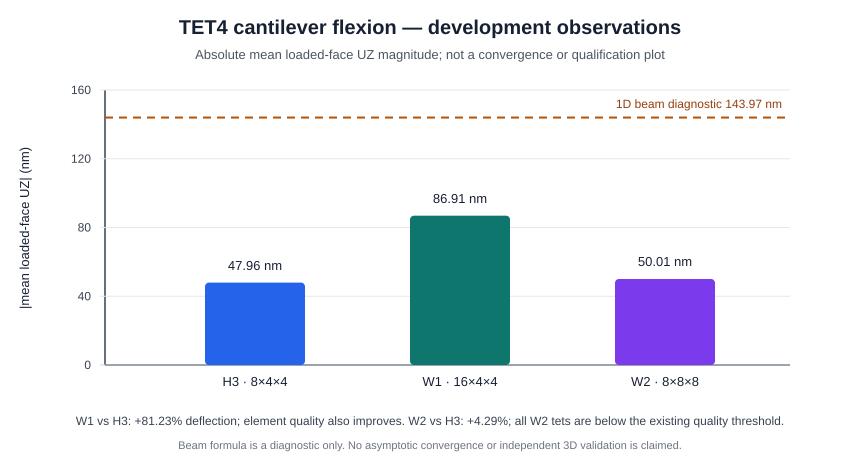

# WP12 accelerated development V&V report

**DEVELOPMENT_ONLY · NUMERICAL_EXECUTION_PERFORMED · FORMAL_QUALIFICATION_NOT_PERFORMED · WP12_STATUS=OPEN · WP13_STATUS=OPEN**

Date: 2026-10-26. This report records bounded development runs requested for WP12 acceleration. It does not change a work-package status, scientific maturity, historical result, or release decision.

## Executive findings

- The bounded TET4 cantilever runs H3, W1, and W2 completed. W1 produced 81.23% more mean loaded-face deflection than H3. W2 produced 4.29% more. The directional meshes also changed element shape substantially, so these three meshes do **not** establish directional or asymptotic convergence.
- WP04 projection, WP05 reduced harmonic, and WP06 modal Newmark selected tests passed on the frozen scientific source identity. WP07 had two passing nodeids and one failure in a reduced-harmonic result round-trip. The physical response assertions preceding the failure passed; serialization failed at `ReducedHarmonicResult.from_dict(result.to_dict())` because `frequency_response` metadata was rejected as inconsistent.
- Selected BEAM2, TET10, HEX8, HEX20, and MITC4 checks passed. HEX8-SRI has no suitable current numerical nodeid in the frozen test snapshot and remains unexecuted.
- R3 campaign allowlist compatibility is implemented and has synthetic coverage. The new R3 formal manifest is still `PREPARED_NOT_AUTHORIZED`; no formal R3 run was made.
- All results are tied to their own source, test, runner, manifest, and receipt identities. No scientific source, scientific test, historical proof, or tolerance was changed.

## Identities and execution boundaries

| Role | Identity | Use |
|---|---|---|
| Frozen scientific source | commit `00428adf38e9397340ac136f6f503a268eb671da`; tree `df4ec667bf746b042c900fad1f86bf542e1a437b` | All development numerical tests and H3/W1/W2 calculations. `solveur.__file__` resolved within this checkout. |
| Frozen test snapshot | commit `77e83b53859d3ad1e13afded6335d29d2f8c4d27`; tree `78436375a7ef674dfd5130f55edbc0757f7f1056` | WP04–WP07 and representative element test nodeids. |
| R3 allowlist runner | commit `8b78db0aa169e787f5f36d6f8a2fa909bdd61489`; tree `b969d1e892e82a2ee114876f8118da8ee2bcd2ac` | Runner source compatibility for the future formal R3 profile; it was not the test harness for the dynamic/element runs. |
| Development test harness | SHA-256 `2a9271fd26164f83325f297e221aa31e2c0b36c1ca083b20c858829572353ae9` | Exact-node pytest execution with nested-JUnit verification. |
| TET4 development harness | integration commit `85af7e7520b997abcc9db2efa735b8bc705b1430`; script SHA-256 `d8a9744e965cfad06b4e994fbb7f83b1b0c7d90c66a9c73c728c0e0a4549cbe5` | Fixed H3/W1/W2 development cases only. The later memory-query fix was not part of these runs. |

The science and test checkouts were clean detached snapshots. The dedicated environment was Python 3.13.17, NumPy 2.2.6, SciPy 1.15.2, h5py 3.14.0, pytest 8.4.1, and threadpoolctl 3.6.0; OpenBLAS 0.3.29; all six configured BLAS/OpenMP thread variables and observed native thread counts were one. No installed `qf-solver` distribution was used. Execution was local and non-attested: no filesystem sandbox or hard CPU/RAM/disk quotas were present.

Raw outputs, displacement arrays, generated models, JUnit files, stdout/stderr, manifests, and receipts remain in the Owner-managed evidence area outside Git. Their content hashes are recorded below. They were not copied into the repository.

## TET4 flexion: H3, W1, and W2

The fixed model uses length 4 m, square section 0.4 m × 0.4 m, isotropic `E=70 GPa`, `nu=0.3`, density 7800 kg/m³, fully fixed translations at `x=0`, and total `Fz=-1 N` distributed by the tributary rule over `x=4 m`. All cases used the same matrix-free CG route, nodal block-Jacobi preconditioner, `rtol=1e-8`, `atol=0`, `maxiter=10,000`, and one numerical thread. Sparse stiffness assembly was performed after the solve for residual/reaction/energy recovery; it did not perform a second solve.

| Case | Grid | TET4 / nodes | Total / fixed / free DOF | Mesh quality min–mean; low-quality / invalid | Mean loaded-face UZ | Load-conjugate displacement | Max translation (node) | CG iterations; normalized free residual |
|---|---:|---:|---:|---:|---:|---:|---:|---:|
| H3 | 8×4×4 | 768 / 225 | 675 / 75 / 600 | 0.09523–0.12505; 0 / 0 | `-4.7956128932e-8 m` | `-4.7956202761e-8 m` | `4.81854e-8 m` (200) | 363; `2.14052e-9` |
| W1 longitudinal | 16×4×4 | 1,536 / 425 | 1,275 / 75 / 1,200 | 0.30105–0.36546; 0 / 0 | `-8.6910285513e-8 m` | `-8.6910292539e-8 m` | `8.74410e-8 m` (404) | 467; `1.65976e-9` |
| W2 transverse coupled | 8×8×8 | 3,072 / 729 | 2,187 / 243 / 1,944 | 0.02541–0.03423; 3,072 / 0 | `-5.0011257613e-8 m` | `-5.0011369691e-8 m` | `5.01898e-8 m` (648) | 734; `1.14837e-9` |

All three meshes have volume `0.6400000000000001 m³`, applied resultant `(0, 0, -1) N`, and applied moment about the fixture origin approximately `(-0.2, 4.0, 0) N·m`. The support force sum is approximately `(0, 0, +1) N`; the support moment is approximately `(+0.2, -4.0, 0) N·m`. The maximum force-balance component was `1.02e-9 N` (W1); the maximum moment-balance component was `3.52e-10 N·m` (W1). The reported free residual normalization is `||r_free||₂ / max(||F_free||₂, 1 N)`. The 1 N floor makes this diagnostic SI-value dependent, not unit invariant.

The discrete energy checks were internally consistent: `2U/W` was `1.0000000000037` (H3), `1.0000000000307` (W1), and `0.9999999999851` (W2). `2U-W` was respectively `1.76e-19 J`, `2.67e-18 J`, and `-7.46e-19 J`. These checks establish algebraic consistency of the solved discrete system, not independent physical accuracy.

The absolute mean-face deflection increased by **81.23%** from H3 to W1 and **4.29%** from H3 to W2. Relative to the 1D Euler–Bernoulli/Timoshenko diagnostic `-1.4397142857e-7 m`, the differences are **66.69%** (H3), **39.63%** (W1), and **65.26%** (W2). The 1D formula is a diagnostic, not a 3D oracle.

Interpretation:

- W1 is compatible with H3 being under-resolved in flexion: its response is substantially more compliant and closer to the beam diagnostic. However, W1 also improves element shape (mean quality 0.125 to 0.365; aspect ratio 5.196 to 2.872), so the response change cannot be attributed to longitudinal refinement alone.
- W2 is not a clean transverse-refinement result. Its mean deflection changes only 4.29%, while all 3,072 elements are below the existing quality threshold, with mean quality 0.0342 and aspect ratio 10.10. The mesh audit returned `WARNING`. This poor shape limits any inference about transverse resolution.
- Neither branch is an asymptotic mesh sequence. The runs do not establish shear locking, a general TET4 error, or a physical solution. A matched-aspect-ratio sequence and/or same-geometry TET10/HEX8 comparison is a reasonable next study, but no further mesh was run here.

The chart displays the absolute deflection magnitudes and the 1D diagnostic:

The frozen H3 baseline matches the previously recorded terminal-face value to the displayed precision; that historical evidence was not edited. The run manifest SHA-256 is `1feb1643219c3b058c98055d7e34029ff33df8b1c853ed9a532292bd6ac652c4`; the campaign receipt SHA-256 is `d3ad9a63b06a3961e6cf282d7080e94032069933a91d4e681db8f204d75e29a0`. Case result hashes: H3 `a8d6bdffd71bc4b8bb77d9b104dc607265c5196571f8c454b10b3edabe0c710e`; W1 `9407ae623a10fe0e5f15ddb02039a3386eb27425acc5c35546517f30b56158b5`; W2 `b71385d822d6d65be08c76e9d6cbc42bb1d08d66e6127533d530cd7952a2a439`. Peak working-set collection failed in these runs (`NOT_MEASURED`); a fix made afterward was checked by its helper but was not used to rewrite or backfill these receipts.

Observed timings were single-run development measurements, not benchmarks: matrix-free solve 0.0562 s / 0.1017 s / 0.2234 s for H3/W1/W2; sparse post-solve assembly 0.0100 s / 0.0146 s / 0.0271 s; total case wall time 0.137 s / 0.188 s / 0.326 s. The solver iteration counts and these timings are machine- and configuration-specific.

## WP04–WP07 regression samples

The WP05–WP07 test invocation manifest SHA-256 was `6e16b4e8a3f1efca08dfc987b958453dd2cc30ae06f91e83c63355000ed2f91e`; all commands selected exact nodeids. WP04 was executed under the earlier development manifest SHA-256 `79ba4ad65e326cf8888e333e2d6f7fc70b1769185ddd43227f6d9226a6dbdf6d` and reconciled from its preserved JUnit after a parser-only runner defect. No scientific group was replayed after its one recorded attempt.

| Area | Result | Numeric/oracle meaning | Evidence |
|---|---|---|---|
| WP04 modal projection | 6/6 PASS, confirmed from the preserved JUnit after correcting the harness parser | Structured symmetric projection versus dense bilinear form; exact-symmetric and tolerated-near-symmetric path checks; significant-asymmetry refusal; coupled 2-DOF eigenproblem. JUnit does not emit error magnitudes. | JUnit SHA-256 `9a27d0c5563fdf76b17897f8c586b83fdbe1cc4cad0077f006fa701bdf743538`; reconciliation record classified the original `SELECTION_MISMATCH` as a runner-only parsing defect; raw files unchanged. |
| WP05 reduced harmonic | 3/3 PASS in 2.885 s | Independent analytical SDOF amplitude/phase; coupled complex projected operators; full-basis comparison with direct Rayleigh route and zero-frequency behavior. Exact measured errors were not emitted by these tests. | JUnit SHA-256 `45b0954738c138195dd941a897e3ccb48d3ebee82796f92d8d0e55009b43f5d8`. |
| WP06 modal Newmark | 4/4 PASS in 3.373 s | Undamped SDOF analytical solution; second-order time refinement; full-basis/direct Newmark agreement; coupled TET4 comparison with independent eigen-expansion. Exact measured errors were not emitted by these tests. | JUnit SHA-256 `ea899fe9af1735819d17ae0d7c5decde156fece3c5a80408dd1f17aa4d8a29a0`. |
| WP07 uniform base acceleration | 2 PASS / 1 FAIL in 2.310 s | Transient constant-acceleration SDOF and TET4 full-consistent-mass-before-reduction checks passed. In the harmonic SDOF case, assertions for the independent relative equation, absolute/relative kinematics, and mass-formation policy passed before serialization failed. | JUnit SHA-256 `5fd455ce869b4f7af6632635691a252b895b8de8878646a2cb5ac6239c032f4d`. |

The exact failing nodeid is `tests/unit/test_wp07_uniform_base_acceleration.py::test_harmonic_base_sdof_matches_independent_full_free_equation_and_absolute_frames`. At the round-trip assertion, `ReducedHarmonicResult.from_dict(result.to_dict())` raises `ValueError: Serialized reduced harmonic result has inconsistent 'frequency_response' metadata.` The check is in the frozen source at `src/solveur/core/results.py` within `_validate_serialized_result_metadata`; the test is at line 257 of the frozen test snapshot. The independent review confirms a real result-contract behavior failure, not a JUnit selection problem. The precise differing nested value has not been isolated without replaying the scientific case; therefore no root-cause fix or scientific verdict is claimed. Treat the WP07 group as non-passing, preserve the failure, and investigate the DTO round-trip before relying on this harmonic serialization path.

The 14 passing WP04–WP06 nodeids exercised established test assertions but did not write observed errors to their JUnit output. This report therefore records their oracle types and execution status, not invented numeric residuals or general validity. To obtain exact errors, a later instrumentation/reporting change would need its own review and a new bounded development attempt; no test assertion or tolerance was changed here.

## Representative element checks

| Family | Nodeids | Result | Bounded evidence |
|---|---|---|---|
| BEAM2 | `tests/verification/test_028_beam2_discrete_vnv.py::test_wp03_analytic_cases_pass_frozen_tolerances_and_replay[BEAM2_STATIC-_beam_static_run]` | PASS, 3.656 s | Existing frozen discrete beam verification case and deterministic replay. One sample only; not general mesh convergence. |
| TET10 | `tests/unit/test_tet10_element.py::test_tet10_patch_test_reproduces_affine_strain_and_energy` | PASS, 1.537 s | Affine patch/energy test. Not curved-geometry or structural convergence evidence. |
| HEX8 | `tests/unit/test_hex8_element.py::test_hex8_stiffness_mass_and_rigid_modes`; `...::test_hex8_affine_field_has_constant_strain_at_all_gauss_points` | 2/2 PASS, 1.486 s | Element identities and affine constant-strain patch. Does not transfer to HEX8-SRI or distorted meshes. |
| HEX20 | `tests/unit/test_hex20_element.py::test_hex20_affine_field_is_exact_at_all_gauss_points`; `...::test_hex20_body_and_quad8_face_loads_preserve_resultants` | 2/2 PASS, 1.818 s | Affine interpolation and body/face-load resultant checks. No curved structural convergence claim. |
| MITC4 | `tests/unit/test_mitc4_dynamics.py::test_mitc4_harmonic_zero_hz_matches_static_with_drilling_condensation` | PASS, 2.990 s | Zero-frequency harmonic/static consistency on its bounded fixture, including drilling condensation. No modal plate convergence claim. |
| HEX8-SRI | No current numerical nodeid selected | NOT_RUN | Historical WP10 evidence remains scoped; standard HEX8 results do not transfer. |

The element campaign manifest SHA-256 is `aca7a6b8f2fe1430c458da37fe652d137f29f70cf85e3df7dfbba5b42a003809`. It contains five exact groups and is marked `DEVELOPMENT_ONLY` / `NOT_AUTHORIZED` for formal qualification. The overall JUnit receipt is in the preserved external run area; per-group JUnit hashes are:

- BEAM2: `3ede752a30c8a8a0cf19b289446a9f8a00c1a6d0cfa95ddcf742a162a064122a`.
- TET10: `3c9b00d17978ed687d91fd78b1c6265bacaf578d1b18100033229be294e601e0`.
- HEX8: `42cd8fa8605beeb9fbb7a4f5b4b92cf5f1020dbde6687f324bd8529f93059af1`.
- HEX20: `1522a8cac67f77d25e9a41b39909cc7ef418ebdfb3353e34d36d61810b75ccdf`.
- MITC4: `68145bf8d4d693d50c455b94360c2524794e142b083ee08816a3390ff0c2f2f4`.

## Capability-level accounting against the 62-row WP12 matrix

This accounting is specific to this accelerated sample and counts matrix rows, not tests. `Bounded sample passed` means a directly selected current-snapshot assertion set passed; it does not mean the capability is fully qualified. `Partial/non-pass` means the row had a current observation but the scope was partial, the overall row had a failure/inconclusive result, or the data were development diagnostics only. `Planned but not run` is the explicit HEX8-SRI coverage gap. The rest had no case in this approved accelerated sample.

| Classification | Count | Capability IDs |
|---|---:|---|
| Bounded sample passed | 8 | `AN-MODAL-BASIS`, `AN-REDUCED-HARMONIC`, `AN-MODAL-NEWMARK`, `EL-BEAM2`, `EL-TET10`, `EL-HEX8`, `EL-HEX20`, `EL-MITC4` |
| Partial / failed / inconclusive | 15 | `EL-TET4`, `AN-BASE-ACCEL`, `LARGE-TET4`, `PERFORMANCE`, `AN-PREPARED`, `AN-EXCITATION`, `AN-STATIC`, `AN-MODAL`, `AN-DIRECT-TRANSIENT`, `AN-DIRECT-HARMONIC`, `ASM-STATIC`, `LOADS-REACTIONS`, `BACKEND-SPARSE`, `MESH-QUALITY`, `IO-HDF5` |
| Planned here but not run | 1 | `EL-HEX8-SRI` |
| Outside this accelerated case set | 38 | `EL-WEDGE6`, `EL-PYRAMID5`, `EL-MITC3`, `EL-DISCRETE-MASS`, `EL-SPRING`, `EL-ROTATING-DISK`, `MAT-ELASTIC`, `MAT-ORTHO`, `MAT-COMPOSITE`, `MAT-J2`, `MAT-CORO-J2`, `MAT-TL`, `MAT-FINITE-POINT`, `MAT-HENCKY`, `MAT-FINITE-J2`, `MAT-FAILURE`, `AN-BUCKLING`, `AN-D01`, `AN-D02`, `AN-NONLINEAR-STATIC`, `AN-J2-COROT`, `AN-CHECKPOINT`, `CONTACT-NORMAL`, `CONTACT-FRICTION`, `CONTACT-C01`, `CONTACT-C02`, `ROTOR-MODAL`, `ROTOR-CAMPBELL`, `CON-MPC`, `CON-RBE2`, `CON-RBE3-RIGID`, `CON-RBE3-WEIGHTED`, `POST-STRESS`, `API-IO`, `API-CLI`, `VNV-TOOLS`, `EXTERNAL-CASES`, `IO-MESH` |

The four groups sum to 62. The classification does not replace the master matrix or alter any official maturity/status.

## R3 compatibility and next gates

The campaign allowlist now explicitly includes `WP12-V2-R3-H1-OPERATOR-AUDIT-002`; the existing command remains pinned to the exact H1 nodeid and includes `-s`. Its dedicated synthetic suite previously returned **10 passed** without importing `solveur`, NumPy, or SciPy. The R3 compatibility change is recorded at commit `8b78db0aa169e787f5f36d6f8a2fa909bdd61489`.

The new revision [V2_R3_MANIFEST_R2.json](../wp12_v2/r3/V2_R3_MANIFEST_R2.json) has SHA-256 `c972688f78c3651ebd92f9121eb700d5b09cbb43d4580d1f135d336ad5a23ef1`. It binds the same frozen science/test identities, the separate R3-compatible runner identity, the 35-entry input inventory, exact nodeid, 300-second limit, one attempt, existing gamma semantics, and a fresh Owner decision. The runner's read-only `VALIDATE` returned `VALIDATED_NOT_AUTHORIZED`; it checked identities, inventory, environment, and import origin without running pytest or a solver. The manifest remains `PREPARED_NOT_AUTHORIZED`; the R2 decision and previous R3 preparation SHA do not transfer. No formal R3 H1 execution occurred.

Before further work:

1. Diagnose the WP07 `frequency_response` round-trip without editing frozen evidence or changing thresholds; any source repair must be a separately authorized candidate change followed by a new identity and regression.
2. For TET4 flexion, prepare a matched-shape refinement or a same-geometry higher-order comparison only after deciding the scientific question and binding a new manifest. Do not infer convergence from H3/W1/W2.
3. Obtain the Owner's separate signed decision for the new R3 manifest if formal R3 execution is desired. This development report is not that decision.
4. Continue additional dynamic and element coverage in bounded exact-node groups; do not expand the test set implicitly from the 62-row inventory.

WP11 remains `CLOSED` on its accepted API/integration scope. WP12 and WP13 remain `OPEN`. No package/release action was taken.
