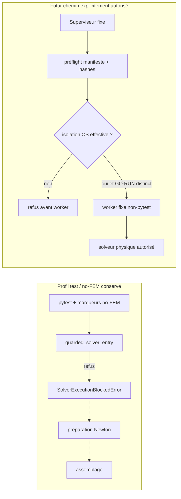

# WP-E01-AD — Implémentation du worker FEM physique et du superviseur

## Résultat

**Décision : `WP_E01_PHYSICAL_EXECUTION_INFRASTRUCTURE=STATICALLY_REVIEWED` ; `WP_E01_PHYSICAL_EXECUTION_PROFILE=NOT_READY`.** Le worker et le superviseur fixes sont implémentés et leurs contrats ont été contrôlés statiquement. Ils ne sont pas runtime-vérifiés. Le validateur refuse volontairement COLLECT et RUN tant qu’aucun fournisseur d’isolation OS effectif n’est disponible. Aucun solveur, assemblage FEM, test pytest, collecte, worker ou subprocessus de campagne n’a été lancé.

La revue indépendante ne relève aucun P0, mais conserve des findings P1 : l’isolation réseau/fichiers/compte n’est pas implémentée et le plafond Newton de 25 est plus strict que les 30 itérations configurées par le test AB d’origine. Le profil reste donc non prêt.

## Identité et preuves préservées

- Worktree : `C:\wpc01-frictionless-public-integration-wt\wp-e01-x`
- Branche : `codex/wp-e01-x-newton-test-remediation-20261021`
- HEAD initial documentaire AC : `a39119a7f6079d6c2ef353b609a743f40e22c666`
- Tree initial WP-E01-AD : `10f61fd10f74557fb3fc8c493728b7623784ef5b`
- Origine : `https://github.com/emptiesvoid-cloud/QF_solver.git`
- Rapport AC préservé : `qualification/0_2_12/wp_e01_ac_physical_fem_execution_profile.md` (SHA-256 `049FEEEA95E2FF3861B49D9F7138457A8495F10ACD143877D62B872952F33FC9`)
- Profil AC épinglé : `qualification/0_2_12/wp_e01_ac_physical_fem_profile.json` (SHA-256 `1facb43fa43a9dfc89436897ad83b097a5ace8d8a952aa714cb8fa28fd949d70`)
- Le garde `src/solveur/core/execution_guard.py` est inchangé (SHA-256 `fe8624948dab00db74d45da9b86f0cbaf128ea590a16689b5aa4bee99b7c6364`).
- Commit de gel worker/profil : `a8b17e1384286f11a7cd2598695607d46176ef95`; tree du gel code/profil : `b955835c26089ab3b681e4661d9bea6dd2b25640`. Le commit du présent rapport suit séparément.
- AA 16/16 PASS, Newton incrémental synthétique VERIFIED_BOUNDED ; AB 16 PASS / 1 FAIL, refus no-FEM avant préparation du solveur et assemblage ; AC 22 contrôles simulés. Ces résultats restent historiques et ne sont pas rerun.

Le nœud physique fixe reste `tests/unit/test_wp_e01uvw_newton.py::test_production_contact_newton_rejects_full_step_then_accepts_reduced_step`, classé `NUMERICAL_UNIT`, hash `973df15eb8fffb8a9fb3af7fcb0365485ce3c582147159556ea1ec2eac3f6e7e`. Les tests AB ne sont pas modifiés.

## Diagnostic AB et frontières

AB a échoué car l’entrée `NonlinearStaticSolver.solve` est décorée par `guarded_solver_entry`. Dans le contexte pytest, le module pytest, `PYTEST_CURRENT_TEST`, un marqueur no-FEM ou le latch d’import font lever `SolverExecutionBlockedError` avant le corps de `solve`, la construction des opérations Newton et l’assemblage. Le refus est donc le comportement attendu du profil offline, pas un défaut du solveur.

Le garde no-FEM n’a pas été neutralisé et aucune variable d’environnement ne l’autorise implicitement. Le worker est un point d’entrée distinct, à cible codée en dur, qui vérifie d’abord le profil, le manifeste, le dépôt et toutes les sources épinglées. Le solveur et les bibliothèques numériques sont importés seulement après ce préflight. Le profil actuel ne peut cependant jamais atteindre cette étape : `OS_ISOLATION_PROVIDER_AVAILABLE=False` provoque un refus pour toute opération.

## Worker fixe

Fichier : `experiments/wp_e01ad_physical_fem_worker.py`.

Il n’expose pas de runner Python générique, de chemin de cas libre, de module ou d’argument de solveur sélectionnable. Il accepte seulement les chemins fixes du runtime manifest et du profil, leurs digests externes, l’identité repository record créée par le superviseur, et le seul scénario AB. Il refuse le contexte pytest et les marqueurs no-FEM hérités au lieu de les effacer. Avant tout import du solveur, il vérifie l’origine, la branche, l’allowlist, les hashes source, le manifeste externe, le reçu COLLECT pour RUN et les autorisations de phase.

Scénario décrit : un TET4, 4 nœuds, 12 DDL, un incrément, matériau isotrope `E=10 000 Pa`, `nu=0,25`, pression `18,75 Pa`, contact GF4 régulier, géométrie et conditions de bord identiques à la fixture AB. Le worker capture le résidu/RHS, la correction réduite, chaque alpha, le mérite et le seuil Armijo, les branches/contact, les digests accepted/trial/material/contact et le commit.

Le worker réalise deux exécutions séquentielles du même cas et compare une projection canonique des traces de recherche, des commits, du résidu relatif, du digest d’état final et du facteur de charge. Le validateur recalcule les digests. Les trois sondes `alpha=1`, `0,5`, `0,25` doivent toutes conserver les digests acceptés et provisoires, y compris les évaluations d’assemblage ; la sonde rejetée `alpha=0,5` n’est plus omise.

**Écart de contrôle à ne pas masquer :** l’AC plafonne Newton à 25 itérations, ce qui est appliqué au worker. Le helper du test AB épinglé configure 30. AD garde le plafond plus strict autorisé par le profil AC ; ce chemin est donc un **variant borné** et ne peut pas être présenté comme reproduction exacte des contrôles du helper d’origine. Aucune preuve ne montre encore que le cas atteint la convergence en 25 itérations. Un futur GO doit accepter explicitement ce plafond ou faire réviser le profil avant le gel ; AD ne l’augmente pas.

## Superviseur Windows

Fichier : `experiments/wp_e01ad_physical_fem_supervisor.py`.

Il n’accepte que `COLLECT` ou `RUN` et les chemins/digests fixes. Le préflight vérifie l’interpréteur Python 3.13.1, le répertoire, l’origine, la branche, HEAD/tree, l’état clean hors répertoire de preuves, le schéma du profil/manifeste, tous les hashes et l’opération. Les appels Git sont locaux, fixes, `shell=False`, no-lazy-fetch, sans hooks/fsmonitor et bornés à 5 s ; ils terminent avant tout enfant de campagne.

Pour une phase future, le superviseur crée le processus enfant suspendu, l’assigne au Job Object, relit ses plafonds, puis reprend son thread. Il fixe `active process limit=1`, `kill-on-close`, aucun breakaway, 256 MiB de mémoire commitée par processus et par Job, 120 s de délai mural par phase, ainsi qu’un plafond Job de 100 s de **temps CPU utilisateur cumulé**. Ce dernier est appliqué par `JOB_OBJECT_LIMIT_JOB_TIME` et relu ; il borne le budget CPU total du Job, ce n’est pas un plafonnement du taux CPU. Le timeout mural et le comptage CPU restent des mesures distinctes.

Les reçus prévus contiennent identité, commande fixe, hashes stdout/stderr, PID, readback des limites, comptabilité Job, durée, état cleanup, inventaire exact COLLECT ou digest du résultat RUN. Le timeout/erreur tente la terminaison du Job et du handle processus, sans reprise automatique. Ces comportements sont uniquement revus dans le code : aucun Job Object n’a été créé ou interrogé sous AD.

## Isolation système : blocage P1

Un Job Object ne restreint ni les ACL de fichiers, ni le réseau, ni les privilèges du compte. Le profil déclare explicitement `filesystem_acl_enforced=false`, `network_enforced=false`, `restricted_account=false` et `verified_by_supervisor=false`. Les chemins read/write sont des **périmètres déclarés**, pas des ACL appliquées : la liste de lecture couvre le dépôt, Python, `site-packages` et `System32`; la sortie prévue est `qualification/0_2_12/wp_e01_ad_execution/`. Le processus futur utiliserait le compte Windows courant ; aucun compte restreint n’est préparé ; le réseau reste accessible selon les droits de ce compte. Les dépendances attendues sont Python, NumPy/SciPy et sources Python du solveur/contact ; aucun Gmsh ou backend FEM natif n’est épinglé dans cette fermeture.

Le validateur runtime exige les quatre attestations d’isolation à `true`, puis refuse encore l’opération car aucun fournisseur OS n’est implémenté. Cela empêche de transformer un champ manifest déclaratif en preuve système. En conséquence, le worker et le profil ne sont pas aptes à un calcul réel. La prochaine étape doit fournir et vérifier effectivement un compte restreint, les ACL d’accès/sortie et l’isolation réseau exigés par un mécanisme Windows adapté ; une description de politique ne suffit pas.

## COLLECT et RUN

Les chemins sont séparés :

- **COLLECT** : manifeste dédié, `pytest --collect-only` sur l’unique nœud, marqueurs no-FEM actifs, guard qui vérifie l’allowlist et un reçu `COLLECTION_ACCEPTED` hashé.
- **RUN** : manifeste distinct, autorisation Owner distincte, même identité source/repository, reçu COLLECT requis et vérifié, puis worker non-pytest fixe. Aucune exécution ne passe par le corps du test pytest ; le garde global n’est pas désactivé.

Le runtime manifest réel n’existe pas. Seul `wp_e01_ad_runtime_manifest.template.json` est présent, avec `runnable=false`, GO ids `null` et placeholders. Les hashes passés au superviseur doivent être liés à un futur Owner GO ; un hash prouve l’intégrité de l’objet fourni mais n’authentifie pas, à lui seul, l’identité de son auteur.

## Contrôles statiques et simulés

- AST parse + compilation en mémoire : **203 fichiers Python sur 204 pins** ; aucun `.pyc` écrit.
- Profil fermé validé et chaque octet des **204 source pins** correspond au SHA-256 déclaré.
- Runtime template : `runnable=false`, même map source que le profil.
- Policy selfcheck simulé, sans pytest/solveur/processus : **50 décisions**, dont **5 acceptées comme formes valides de schéma** et **45 refusées** (profil absent, JSON malformé, manifeste mal formé ou identité incorrecte, cible/source incorrecte, GO/reçu manquant ou altéré, limites et isolation insuffisantes, mutation d’état, incohérence de rejeu, mauvais readback Job Object).
- Le selfcheck simule temporairement en mémoire la présence future d’un fournisseur OS pour vérifier le reste du schéma ; cela ne crée ni n’atteste une isolation.
- Source review des imports/chemins : pas de Gmsh, backend natif, socket/réseau, worker numérique ou solver importé avant le préflight. Seuls les appels Git bornés du superviseur et le processus fixe prévu apparaissent dans le profil.
- `git diff --cached --check` : PASS après staging.
- **Aucun pytest, COLLECT, RUN, FEM, Gmsh, backend natif ou calcul Newton physique n’a été lancé.**

## Revue indépendante

Un reviewer distinct a réalisé une revue read-only du code et du profil. **Aucun P0.** Le reviewer a confirmé les 204 pins, les plafonds Job, la création suspendue/assignation avant reprise, le contrôle d’immutabilité des trois essais et la comparaison canonique de deux rejeux. La revue est statique et ne prouve aucune application runtime des limites.

Findings :

- **P1 — isolation OS absente.** Pas de mécanisme effectif réseau/ACL/compte restreint, le validateur bloque les phases ; profil NOT_READY.
- **P1 — parité du contrôle Newton.** Cap AD/AC 25 contre 30 dans le helper AB ; préserver explicitement le variant borné, sans revendiquer une reproduction exacte.
- **P1 — runtime non vérifié.** Aucune preuve d’affectation réelle au Job, de readback effectif, de timeout/cleanup, ou de confinement des accès.
- Aucun finding P0. La revue ne constitue pas une validation scientifique Armijo.

## Fichiers AD et empreintes

| Fichier | SHA-256 |
|---|---|
| `experiments/wp_e01ad_execution_contract.py` | `cfca8ff3c0fca96c4233dd93f975162cff6537ea64576c54364b1e91515167c4` |
| `experiments/wp_e01ad_physical_fem_worker.py` | `26b07aa2d7561c38d13e9c123dff4e933608b6754ce512bf5fa1da339834fd2e` |
| `experiments/wp_e01ad_physical_fem_supervisor.py` | `824223c056a8b854d7d4f1ac87a1f8dc937774e6cabf5646064b484c0e9c9887` |
| `experiments/wp_e01ad_collection_guard.py` | `ca3ad3154f73279cf887bf6ccc1c84876fb61288602c3431c469a3acbd1e9698` |
| `qualification/0_2_12/wp_e01_ad_profile.json` | `3471aef472cac1b40b9c7e2898ca36bd9e8785b69fb0495b3e1d17dce38368aa` |
| `qualification/0_2_12/wp_e01_ad_runtime_manifest.template.json` | `51c97dd206e999bf4fe1808e496b612d05e90dd5199af1758281d7ff85749210` |

Le profil contient 204 pins : la fermeture AC de 199 entrées, le profil AC, et les quatre sources AD. Les sources scientifiques/protégées (test AB, `conftest.py`, execution guard et sources Newton/contact) restent inchangées dans ce travail.

## État final et décision suivante

| Indicateur | État AD |
|---|---|
| `WP_E01_PHYSICAL_EXECUTION_INFRASTRUCTURE` | `STATICALLY_REVIEWED` (sans preuve runtime) |
| `WP_E01_PHYSICAL_EXECUTION_PROFILE` | `NOT_READY` |
| `PRODUCTION_ARMIJO_CERTIFICATE` | `NOT_VERIFIED` |
| `NATIVE_FEM_VNV` | `NOT_RUN` |
| `INCREMENTAL_NEWTON` | `VERIFIED_BOUNDED` (preuve synthétique AA uniquement) |
| `GENERAL_SCIENTIFIC_QUALIFICATION` | `NOT_ACQUIRED` |
| `AUTHORITATIVE_INTEGRATION` | `PENDING` |
| `PUBLIC_RELEASE` | `NOT_AUTHORIZED` |
| `COLLECT` | `NOT_RUN` |
| `RUN` | `NOT_RUN` |

Le prochain Owner GO ne devrait pas autoriser immédiatement COLLECT/RUN. Il doit d’abord autoriser un jalon d’infrastructure OS : compte à privilèges restreints, ACL effectives sur lecture/sortie, isolation réseau, puis vérification runtime séparée du Job Object et du cleanup. Une fois ces P1 résolus, un GO-COLLECT hashé pourra être demandé. Le GO-RUN restera distinct, avec reçu COLLECT accepté, nouveau gel incluant le HEAD/tree final et acceptation explicite du plafond Newton de 25 (ou profil révisé séparément). Aucun résultat Armijo physique n’est établi.
