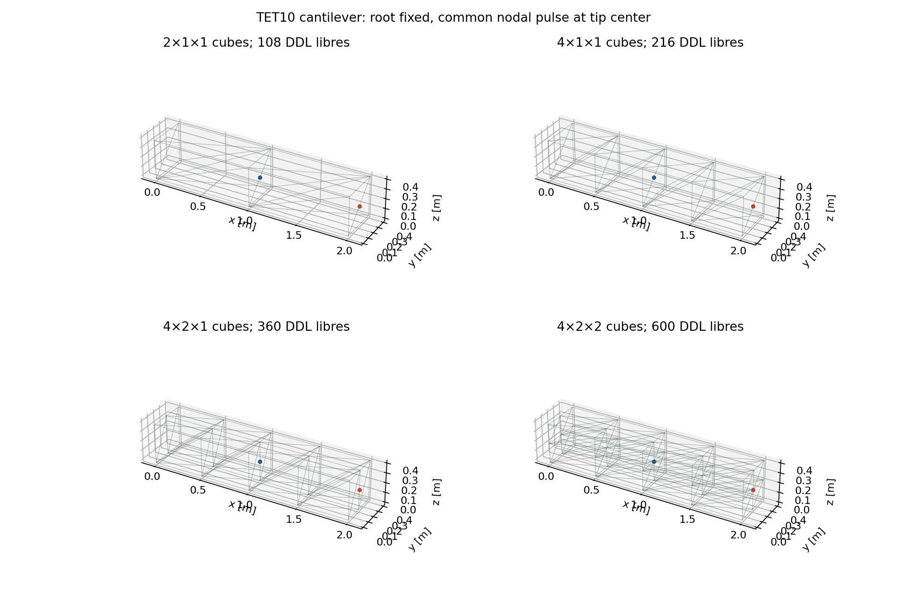
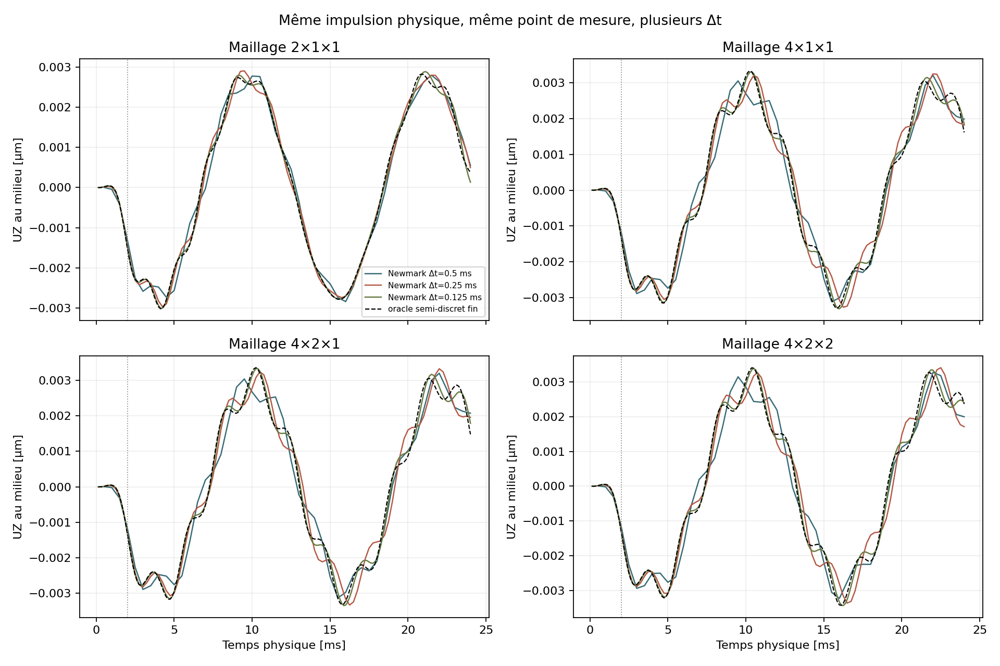
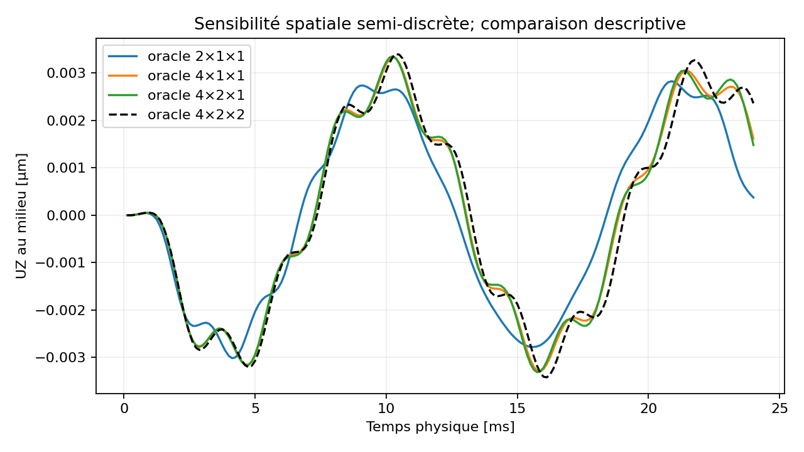
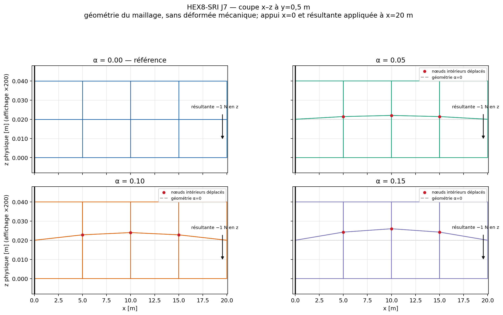
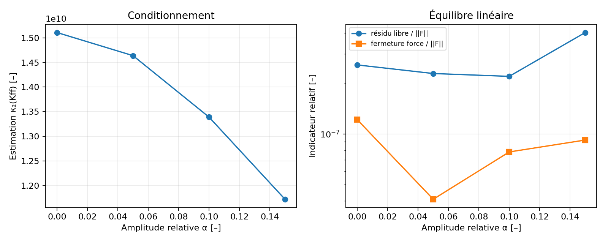

# J10 — résultats reproductibles et préparés pour la galerie

Tous les fichiers sont des diagnostics exploratoires. Ils ne constituent pas une qualification générale du solveur. Aucun résultat n’a été publié sur le site.

## Modèles

### TET10, impulsion de force commune

Le fichier [`result.json`](tet10_fixed_excitation/result.json), le CSV des historiques, l’archive d’état et les trois figures documentent une impulsion triangulaire de `−1 N` entre `0` et `2 ms`, appliquée au centre de la face d’extrémité. La mesure `UZ` est à `(1;0,2;0,2) m`; le modèle observe jusqu’à `24 ms`. Quatre maillages couvrent `12–96` éléments et `108–600` DDL libres.

La référence temporelle est semi-discrète et partage les matrices `M/K` assemblées de chaque maille. La comparaison entre maillages est une sensibilité descriptive, pas une erreur absolue au continuum. L’archive ne contient pas de champs complets à chaque instant; aucune animation temporelle de déformée n’est disponible.

Contrat : [`research/j10_transient/contracts/tet10_fixed_excitation_contract.json`](../../../j10_transient/contracts/tet10_fixed_excitation_contract.json). Source du calcul : `62ab1f57079510e7877cb0fb8f8ce8e9e3c4d26a`.

### HEX8-SRI, distorsion intérieure à enveloppe constante

Les fichiers sous [`hex8_j7_distortion/`](hex8_j7_distortion/) conservent l’état, métriques et figures du balayage `α=0–0,15`. Le niveau zéro reproduit exactement la matrice et l’état J7 quasi dégénérés. Les seuils historiques et verdict `FAIL` ne sont pas modifiés. Aucun oracle indépendant de déplacement n’existe pour ce modèle.

La coupe x–z à `y=0,5 m` est générée par [`plot_distortion_section.py`](../../../j10_hex8/plot_distortion_section.py), depuis le NPZ archivé. L’axe vertical est agrandi visuellement ×200, avec graduations en mètres réels. Le PNG 3D original du runner est conservé dans le dossier, mais la coupe est plus lisible pour une présentation.

Contrat : [`research/j10_hex8/contracts/hex8_j7_distortion_corrective_contract_003.json`](../../../j10_hex8/contracts/hex8_j7_distortion_corrective_contract_003.json). Source du calcul : `2999fb980ccfd3b7fe97cb724b1be43330507879`.

### TET10, test de route modale

Les fréquences QF et la résolution dense sur les mêmes opérateurs sont dans [`tet10_modal_route/`](tet10_modal_route/). Les quatre modes concordent à `4,22×10⁻¹⁵` relatif au maximum. Ce contrôle ne fournit pas de référence de continuum.

Contrat : [`research/j10_modal/contracts/tet10_modal_route_smoke_corrective_contract.json`](../../../j10_modal/contracts/tet10_modal_route_smoke_corrective_contract.json). Source du calcul : `1b3e7d365ccfc8675fba9c796a2fdfebc579c4b7`.

## Reproduction

Depuis un worktree J10 propre, avec l’enveloppe de développement locale J10 enregistrée et un thread numérique, utiliser le nodeid exact du contrat au moyen de `scripts/development_autonomous.py`. Les calculs ont utilisé Python `3.13.1`, NumPy `2.2.6`, SciPy `1.15.2` et Matplotlib `3.10.3`.

Les contrôles logiciels ciblés passent via le runner de développement. Les tentatives HEX8 1/2 et modale 1 ont échoué au harnais; leurs statuts, empreintes et reçus assainis sont dans [`attempt_history/`](attempt_history/). Les journaux bruts restent dans le stockage local ignoré `.codex/development-runs/` pour éviter de diffuser des racines locales.

Les reçus de calcul et préflight assainis portent les SHA bruts des reçus privés, leurs empreintes de source, horaires, budgets et ressources observées. [`sha256_manifest.json`](sha256_manifest.json) donne l’empreinte de chaque fichier de cette archive. Le manifeste n’inclut pas sa propre empreinte.

Données regroupées pour intégration ultérieure : [`site_data.json`](site_data.json). Aucun champ extrapolé, verdict historique ou résultat absent n’est complété artificiellement.
